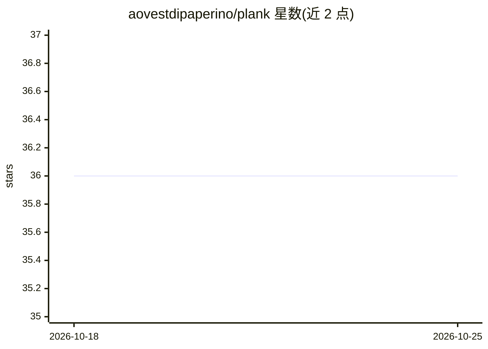

# aovestdipaperino/plank

⭐ 36 · Rust · MIT · 推送 2026-10-24 · [GitHub](https://github.com/aovestdipaperino/plank) · [官网](https://plank-agent.dev) · 个人维护

**macOS 本地运行 DeepSeek 等模型的终端编程 agent**

Rust 编写的交互式编程 agent，提供 Ratatui 全屏 TUI、终端 REPL 与单次 headless 模式，内置 shell、文件读写/编辑、web 等 agent 工具与子 agent 机制。本地推理通过 ds4 C 引擎（Metal 后端）运行 DeepSeek V4 Flash / V4.1 Flash / Qwen3.8，Gemma 4 与 Flint 则由自带 Rust 引擎（Metal/CPU）运行；需 GGUF 模型文件，默认 DeepSeek 模型约 87 GB 且要求 96 GB 内存。支持 MTP 投机解码、KV 检查点恢复与断点续传下载。仅通过 Homebrew 分发，macOS 优先，其他平台回退 echo stub。

## 筛选速览

| 维度 | 判定 | 备注 |
|---|---|---|
| AI 角色 | `ai-native` | 本体是模型或模型工具 |
| 许可风险 | `permissive` | MIT |
| 部署形态 | `library` | 以包/库形式分发 |
| 模型依赖 | locked-api |  |
| 硬件要求 | — | 无带数字的原话,不猜 |
| 安装摩擦 | `high` | 编译与系统依赖俱全 |
| 成熟度 | — | 结构信号不足 |

## 能力要点

- Ratatui 全屏 TUI：markdown 渲染、生成中可输入排队、/toks 速度图表
- 五个模型家族本地推理：DeepSeek/Qwen 走 ds4 C+Metal，Gemma 4/Flint 走纯 Rust 引擎
- MTP 投机解码默认开启，带置信度剪枝与中途开关
- 检查点/回滚/恢复快照 KV，免重新 prefill

## 适用场景

- 在 Mac 上本地跑编程 agent 完成代码编辑与 shell 任务
- 生成过程中插问 /btw 侧问题而不打断主任务
- 离线/无 API key 环境下使用开源模型编码

## 场景标签

`编码 Agent` `推理引擎` · 领域:编码与开发

## 证据(README 行号)

> L13: Plank is an interactive coding agent with a Ratatui TUI, a plain terminal REPL, a one-shot headless mode, and a set
> L15: > **macOS first.** DeepSeek and Qwen inference uses the original ds4 C engine with the Metal backend, linked via th
> L44: - **Missing submodule (or `PLANK_NO_DS4=1`):** plank still builds and runs Gemma 4 and Flint for real on its native

## 星数曲线

2026-10-18 36 → 2026-10-25 36（+0）

---
*卡片 v1 · prompt 1.4 · 生成 2026-10-25 · 置信度 high · 依据 README sha `ff76418b2308` · [字段定义](../../DATASET.md)*
