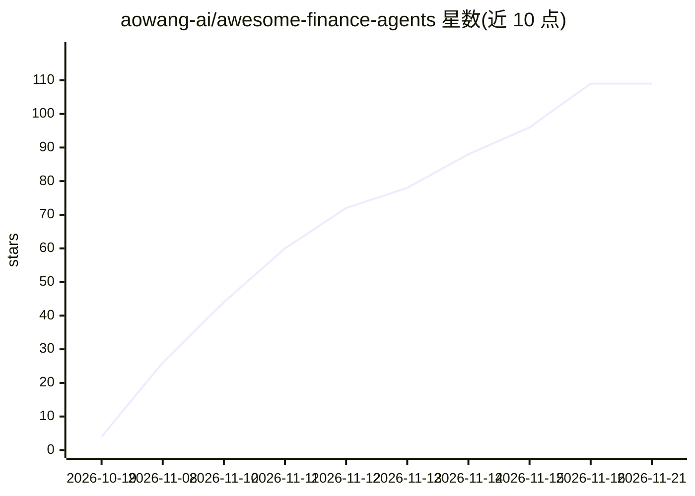

# aowang-ai/awesome-finance-agents

⭐ 109 · JavaScript · CC0-1.0 · 推送 2026-11-19 · [GitHub](https://github.com/aowang-ai/awesome-finance-agents) · [官网](https://finance-agents.dev) · 个人维护 · 中文 README

**开源金融 AI agent 双语策展清单：按金融职能与可靠性组织**

面向金融 LLM agent 的开源项目策展清单（awesome list），中英双语，按金融职能分 10 章：数据与工具（市场数据、MCP 服务器、券商官方 agent 工具包、技能包）、投研、多智能体决策、交易与组合、量化自动化、会计、风险合规、个人财务、评测与回测防泄漏。每章说明解决的问题、列出可研究的项目并附一条 pitfall 提示；不收录 star 数以保持时效，CI 运行 awesome-lint 与每周链接检查。声明非投资建议。

## 筛选速览

| 维度 | 判定 | 备注 |
|---|---|---|
| AI 角色 | `ai-knowledge` | 知识聚合/清单类 |
| 许可风险 | `viral` | CC0-1.0 |
| 部署形态 | `None` |  |
| 模型依赖 | — | README 未给出锁定关系 |
| 硬件要求 | — | 无带数字的原话,不猜 |
| 安装摩擦 | `low` | 无编译、无系统依赖或容器化 |
| 成熟度 | — | 结构信号不足 |

## 能力要点

- 按金融职能组织 10 个章节，覆盖数据、投研、交易、合规、评测、回测
- 收录券商/交易所官方 agent 工具包（Alpaca、OKX、Kraken、Longbridge、Futu 等）
- 以 (sim)/(live)/(paper) 标注模拟盘、实盘或论文代码
- 每章附 pitfall 失败模式提示，可作设计评审检查表

## 适用场景

- 构建投研 agent 时按章节路线（1→2→9）查找数据源与研究框架
- 为交易 agent 寻找券商 MCP 服务器与回测工具
- 做面试或设计评审时用各章 pitfall 作失败模式清单

## 场景标签

`精选清单` `金融量化` · 领域:学习与行业

## 证据(README 行号)

> L3: > Open-source LLM agents for finance, organized by job: research, trading, operations, risk & compliance, personal f
> L9: Each chapter answers: what problem it solves, which open-source projects to study, and one pitfall tip. Star counts 

## 星数曲线

2026-10-19 4 → 2026-11-21 109（+105）

---
*卡片 v1 · prompt 1.4 · 生成 2026-11-17 · 置信度 high · 依据 README sha `b4c84a29267e` · [字段定义](../../DATASET.md)*
