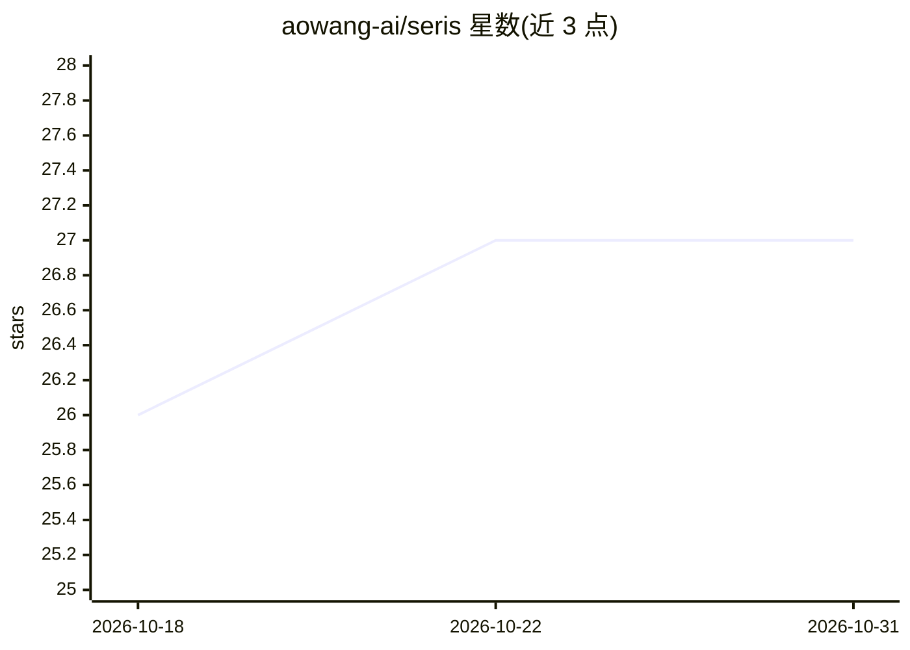

# aowang-ai/seris

⭐ 27 · TypeScript · Apache-2.0 · 推送 2026-10-08 · [GitHub](https://github.com/aowang-ai/seris) · [官网](https://seris.im) · 组织维护 · 中文 README

**桌面端 AI 交易研究助手：图表旁对话、回测与自选模型**

面向交易者的开源 macOS 桌面应用（Tauri 构建）：在实时 K 线图旁与 AI 对话分析行情，支持加密货币、股票、ETF、商品、外汇与指数；可生成 TypeScript 策略并在本地对 Binance 现货或 Hyperliquid 永续历史 K 线回测，输出收益、回撤、费用与权益曲线。模型自选（BYO）：云端服务商、OpenAI/Anthropic 兼容端点或 Ollama/LM Studio 本地服务器。v0.1.2 仅支持 Apple Silicon，无实盘下单。

## 筛选速览

| 维度 | 判定 | 备注 |
|---|---|---|
| AI 角色 | `ai-native` | 本体是模型或模型工具 |
| 许可风险 | `permissive` | Apache-2.0 |
| 部署形态 | `library` | 以包/库形式分发 |
| 模型依赖 | local-ok | 支持本地模型 |
| 硬件要求 | — | 无带数字的原话,不猜 |
| 安装摩擦 | `low` | 无编译、无系统依赖或容器化 |
| 成熟度 | — | 结构信号不足 |

## 能力要点

- 图表旁 AI 对话，可分享当前品种、周期与选区
- 生成 TypeScript 策略并本地回测（Binance 现货/Hyperliquid 永续）
- 接入云端服务商、OpenAI/Anthropic 兼容端点或 Ollama/LM Studio
- 会话、自选与策略本地存储，界面支持中英文

## 适用场景

- 看盘时让 AI 帮我解读某次行情波动
- 把一个策略想法快速写成代码并本地回测验证
- 用自己选的模型（含本地 Ollama）做市场研究

## 场景标签

`金融量化` · 领域:学习与行业

## 证据(README 行号)

> L3:  Seris — open-source desktop AI trading assistant
> L27: |**Test a strategy idea**|Ask for a TypeScript strategy, review its source before saving, and backtest against hist
> L78: **Bring your own model.** Seris supports cloud providers and local models through Ollama or LM Studio, including cu

## 星数曲线

2026-10-18 26 → 2026-10-31 27（+1）

---
*卡片 v1 · prompt 1.4 · 生成 2026-10-26 · 置信度 mid · 依据 README sha `80a1ba6b7f4d` · [字段定义](../../DATASET.md)*
