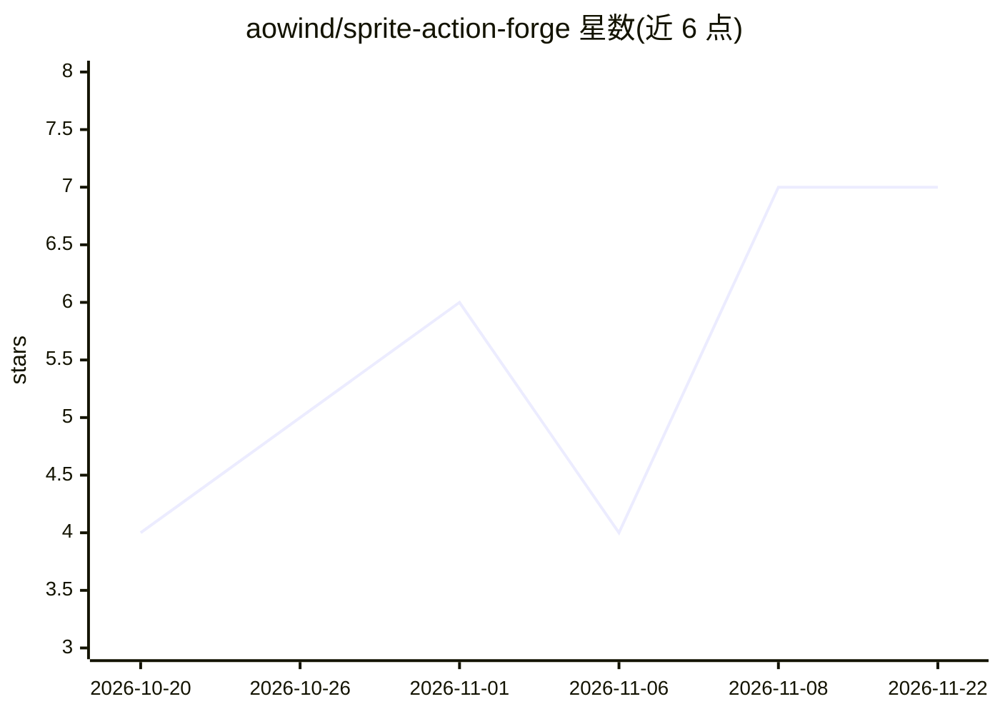

# aowind/sprite-action-forge

⭐ — · [GitHub]() · 个人维护 · 中文 README

**一张立绘本地生成整套 2D 游戏动作精灵表**

面向游戏开发者的本地流水线工具：输入单张角色立绘，通过本地 ComfyUI 服务调用 MiniMax H3 视频/扩散模型生成动作视频，再抽帧对齐生成精灵表（webp）与元数据（json），覆盖站立/跑动/攻击/技能/挨打等动作。提供配方表、循环质量分、五条使用铁律与排查文档；要求 8GB 显存 GPU、本地 ComfyUI ≥0.31、指定 safetensors 权重文件，不支持 GGUF 格式权重。

## 筛选速览

| 维度 | 判定 | 备注 |
|---|---|---|
| AI 角色 | `ai-native` | 本体是模型或模型工具 |
| 许可风险 | `none` | — |
| 部署形态 | `library` | 以包/库形式分发 |
| 模型依赖 | — | README 未给出锁定关系 |
| 硬件要求 | `gpu-8g` | |
| 安装摩擦 | `medium` | 含编译或系统依赖之一 |
| 成熟度 | — | 结构信号不足 |

## 能力要点

- 单张立绘本地生成 idle/run/attack/skill/hurt 等动作精灵表
- 本地运行，8GB 显存可用（lowvram 启动 + KJNodes 压显存节点）
- 输出 webp 精灵表 + json 元数据，含循环质量分判定
- 特效独立成精灵，支持与游戏状态机/位移/特效叠加对接

## 适用场景

- 把角色立绘变成游戏里可直接播放的动作动画
- 为独立游戏批量生成角色与怪物的精灵表
- 生成刀光、落雷等可独立调整位置的技能特效

## 场景标签

`视频生成` · 领域:内容生成

## 证据(README 行号)

> L3: > **一张立绘 → 一整套游戏动作精灵表。全部本地跑（ComfyUI + MiniMax H3），8GB 显存即可。**
> L48: - 有角色/怪物的**立绘或设定图**，要把它变成游戏里能播的动作（站立 / 跑动 / 走动 / 攻击 / 技能 / 挨打）
> L57: |MiniMax H3 模型|放 ComfyUI 的 models 目录。**具体文件名见 `scripts/comfy_client.py` 顶部常量**（UNET/CLIP/VAE/TurboLoRA）|

## 星数曲线

2026-10-20 4 → 2026-11-22 7（+3）

---
*卡片 v1 · prompt 1.4 · 生成 2026-11-20 · 置信度 mid · 依据 README sha `0481177b5d82` · [字段定义](../../DATASET.md)*
