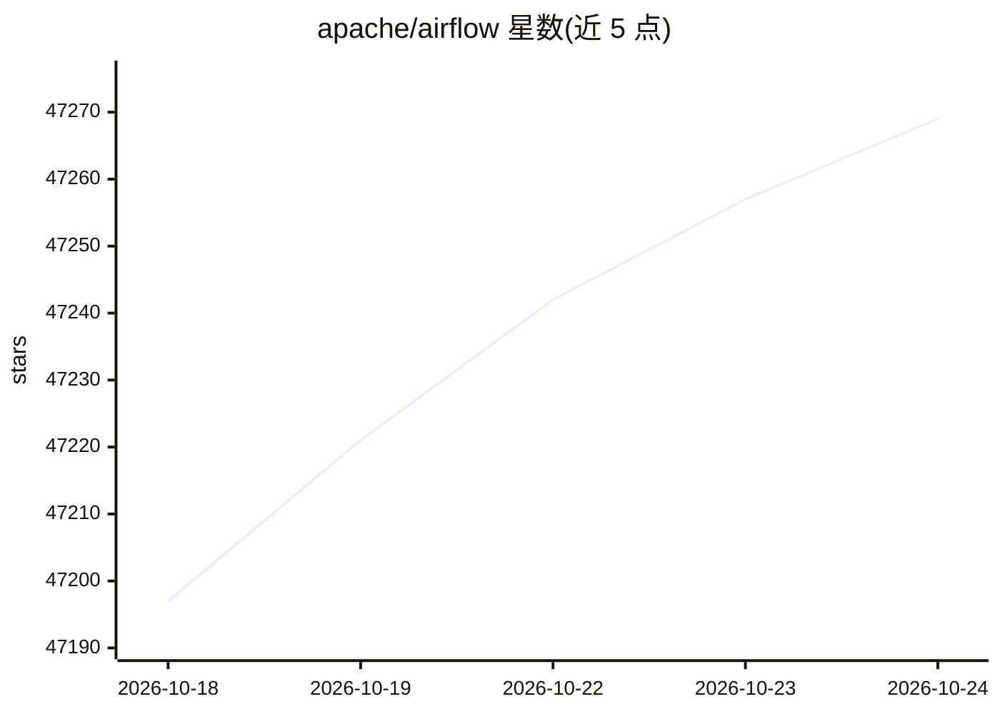

# apache/airflow

⭐ 47,269 · Python · Apache-2.0 · 推送 2026-10-23 · [GitHub](https://github.com/apache/airflow) · [官网](https://airflow.apache.org/) · 组织维护

**数据与 AI 工作流的编排平台：用代码编写、调度和监控**

Apache 软件基金会的工作流编排平台，以代码定义工作流（Dag），由调度器按依赖关系在 worker 上执行任务，配合 CLI 与 Web 界面监控运行中的流水线。工作流以代码形式定义，便于版本管理、测试与协作。任务要求幂等，任务间通过 XCom 传递元数据而非大批量数据；定位为批处理编排，非流式方案，也非 agent 本身。README 提到其广泛用于编排机器学习与基于 LLM 的工作负载（数据准备、工具调用、模型调用、评估等步骤）。通过 PyPI 配约束文件安装，官方支持 pip 与 uv。

## 筛选速览

| 维度 | 判定 | 备注 |
|---|---|---|
| AI 角色 | `ai-enhanced` | 去掉 AI 部分产品仍成立 |
| 许可风险 | `permissive` | Apache-2.0 |
| 部署形态 | `self-host` | docker 或自建部署 |
| 模型依赖 | — | README 未给出锁定关系 |
| 硬件要求 | — | 无带数字的原话,不猜 |
| 安装摩擦 | `low` | 无编译、无系统依赖或容器化 |
| 成熟度 | — | 结构信号不足 |

## 动量与使用信号

- 维护:`active` — 距上次 push 0.6 天,年发版 22,410 位贡献者
- 涨星:近 1 天 **+8**(自 20261016 起算)
- 安装:pypi 包 `apache-airflow` 月下载 7,196,244

## 能力要点

- 以代码定义 Dag，调度器按依赖在 worker 数组上执行任务
- Jinja 模板引擎支持自定义，内置多种 operator 可扩展
- Web UI 提供 Dags、Assets、Grid、Graph、Backfill 等视图
- 仅官方支持 pip/uv 安装，需配合约束文件保证可重复安装

## 适用场景

- 编排 ETL/ELT 数据流水线并监控生产运行
- 编排机器学习训练、再训练、评估与部署流程
- 协调 LLM/AI 流水线中的数据准备、工具调用与模型调用步骤
- 按日期区间回填历史数据

## 场景标签

`工作流自动化` `MLOps` · 领域:效率与自动化

## 证据(README 行号)

> L21: Apache Airflow (or simply Airflow) is a platform to programmatically author, schedule, and monitor workflows.
> L35: Beyond traditional data pipelines, Airflow is widely used to orchestrate machine learning workflows — training, ret
> L107: > Note: Only `pip` and `uv` installation is currently officially supported.

## 星数曲线

2026-10-18 47,197 → 2026-10-24 47,269（+72）

---
*卡片 v1 · prompt 1.4 · 生成 2026-10-18 · 置信度 mid · 依据 README sha `94d2f8f673b0` · [字段定义](../../DATASET.md)*
