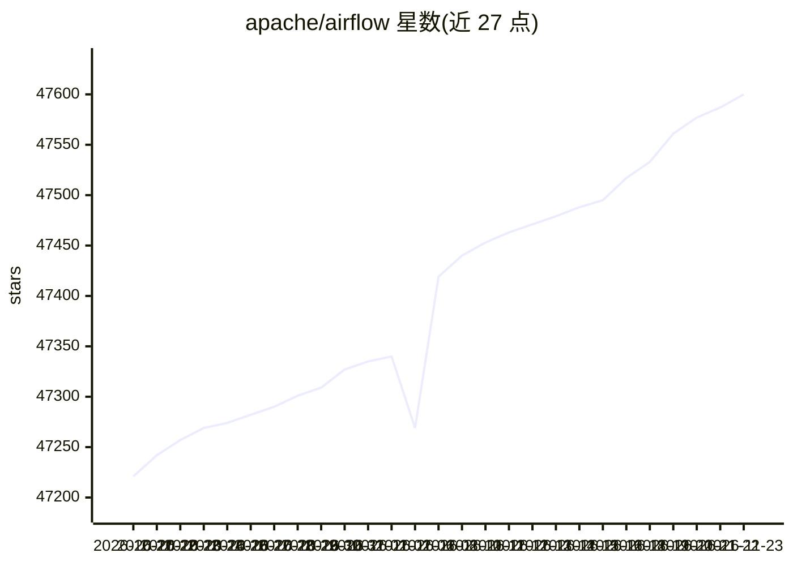

# apache/airflow

⭐ 47,600 · Python · Apache-2.0 · 推送 2026-11-22 · [GitHub](https://github.com/apache/airflow) · [官网](https://airflow.apache.org/) · 组织维护

**给数据/ML 团队编排调度监控工作流的平台**

以代码方式（Dag）定义、调度并监控工作流的平台：调度器按依赖关系在 worker 上执行任务，提供命令行工具与 Web UI（Dags/Assets/Grid/Graph/Backfill 等视图）。核心面向静态、缓慢变化的工作流，任务要求幂等、不传递大数据量。README 说明其广泛用于编排机器学习工作流（训练、再训练、评估、部署）及 agentic/LLM 工作负载，但自身不做 agent。仅支持 POSIX 系统，Windows 需 WSL2 或容器；生产环境仅支持 Linux 发行版。

## 筛选速览

| 维度 | 判定 | 备注 |
|---|---|---|
| AI 角色 | `ai-enhanced` | 去掉 AI 部分产品仍成立 |
| 许可风险 | `permissive` | Apache-2.0 |
| 部署形态 | `self-host` | docker 或自建部署 |
| 模型依赖 | — | README 未给出锁定关系 |
| 硬件要求 | — | 无带数字的原话,不猜 |
| 安装摩擦 | `low` | 无编译、无系统依赖或容器化 |
| 成熟度 | — | 结构信号不足 |

## 动量与使用信号

- 维护:`active` — 距上次 push 0.6 天,年发版 22,410 位贡献者
- 涨星:近 1 天 **+8**(自 20261016 起算)
- 安装:pypi 包 `apache-airflow` 月下载 7,196,244

## 能力要点

- 以代码定义 Dag，支持动态生成与参数化，Jinja 模板可扩展
- 调度器按依赖在多 worker 上执行任务，附 CLI 与多视图 Web UI
- provider 包独立 SemVer，可单独安装（如 postgres、google extras）
- README 明确支持编排 ML 训练/再训练/评估/部署与 LLM 工作负载

## 适用场景

- 搭建定时 ETL/ELT 数据管道并监控运行状态
- 编排机器学习的训练、再训练与部署流程
- 以批处理方式从数据流拉取数据做近实时处理

## 场景标签

`工作流自动化` `MLOps` · 领域:效率与自动化

## 证据(README 行号)

> L21: Apache Airflow (or simply Airflow) is a platform to programmatically author, schedule, and monitor workflows.
> L35: Beyond traditional data pipelines, Airflow is widely used to orchestrate machine learning workflows — training, ret
> L37: Airflow is commonly used to process data, but has the opinion that tasks should ideally be idempotent (i.e., result

## 星数曲线

2026-10-21 47,221 → 2026-11-23 47,600（+379）

---
*卡片 v1 · prompt 1.4 · 生成 2026-11-22 · 置信度 high · 依据 README sha `2bc0c5a29b19` · [字段定义](../../DATASET.md)*
