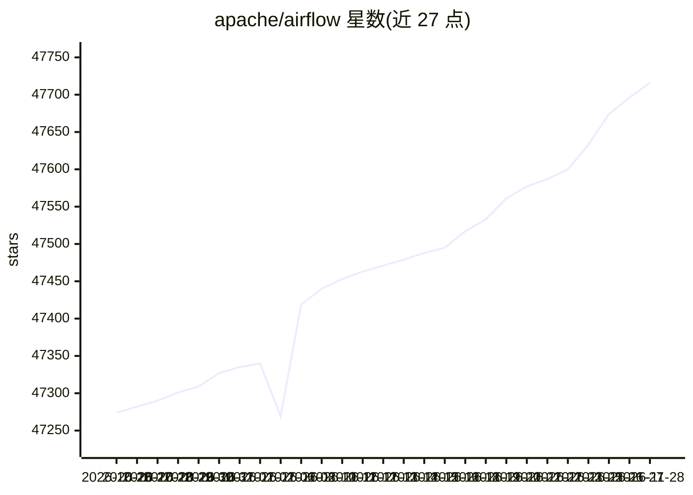

# apache/airflow

⭐ 47,716 · Python · Apache-2.0 · 推送 2026-11-27 · [GitHub](https://github.com/apache/airflow) · [官网](https://airflow.apache.org/) · 组织维护

**以代码定义、调度并监控工作流的数据编排平台**

Apache Airflow 是以代码（Dag）形式编写、调度和监控工作流的平台：调度器按依赖关系在 worker 上执行任务，提供命令行工具与用户界面（Dags/Assets/Grid/Graph/Backfill 等）用于可视化运行、监控与排查。设计上要求任务幂等、任务间不传递大数据量，不适合流式处理，适合静态、缓慢变化的工作流；通过 provider 发行版扩展对接外部服务。安装以 PyPI 配合约束文件为主，Windows 仅经 WSL2 或容器运行。

## 筛选速览

| 维度 | 判定 | 备注 |
|---|---|---|
| AI 角色 | `ai-enhanced` | 去掉 AI 部分产品仍成立 |
| 许可风险 | `permissive` | Apache-2.0 |
| 部署形态 | `self-host` | docker 或自建部署 |
| 模型依赖 | — | README 未给出锁定关系 |
| 硬件要求 | — | 无带数字的原话,不猜 |
| 安装摩擦 | `low` | 无编译、无系统依赖或容器化 |
| 成熟度 | — | 结构信号不足 |

## 动量与使用信号

- 维护:`active` — 距上次 push 0.6 天,年发版 22,410 位贡献者
- 涨星:近 1 天 **+8**(自 20261016 起算)
- 安装:pypi 包 `apache-airflow` 月下载 7,196,244

## 能力要点

- 以代码定义 Dag，调度器按依赖在 worker 数组上执行任务
- Rich UI 提供运行可视化、进度监控与问题排查
- PyPI 发布并以逐版本约束文件保证可重复安装
- 通过 provider 发行版扩展（postgres、google 等 extras）

## 适用场景

- 编排 ETL/ELT 数据管道并监控生产运行
- 调度机器学习训练、再训练、评估与部署流程
- 以批量方式从流中拉取数据做实时数据处理

## 场景标签

`工作流自动化` `MLOps` · 领域:效率与自动化

## 证据(README 行号)

> L21: Apache Airflow (or simply Airflow) is a platform to programmatically author, schedule, and monitor workflows.
> L25: Use Airflow to author workflows (Dags) that orchestrate tasks. The Airflow scheduler executes your tasks on an arra
> L35: Beyond traditional data pipelines, Airflow is widely used to orchestrate machine learning workflows — training, ret

## 星数曲线

2026-10-26 47,274 → 2026-11-28 47,716（+442）

---
*卡片 v1 · prompt 1.4 · 生成 2026-11-24 · 置信度 mid · 依据 README sha `b101f206214c` · [字段定义](../../DATASET.md)*
