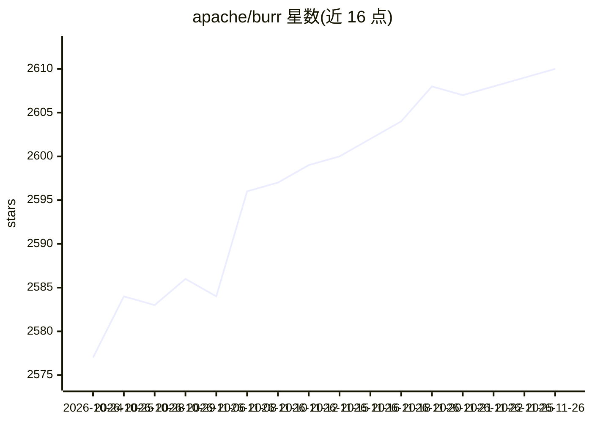

# apache/burr

⭐ 2,610 · Python · Apache-2.0 · 推送 2026-11-25 · [GitHub](https://github.com/apache/burr) · [官网](https://burr.apache.org/) · 组织维护

**开发者构建状态机式 LLM 应用（代理、聊天机器人）的 Python 框架**

Apache Burr (incubating) 提供基于 Python 函数的状态机构建库，用于开发聊天机器人、Agent、模拟等决策类应用。核心组件包括：无依赖的低抽象 Python 库、可实时追踪/监控/调试执行遥测的 UI 服务器，以及状态持久化与遥测的可插拔集成。应用以状态机（图/流程图）形式表达，支持人类反馈与自持久化工作流，也覆盖非 LLM 场景。以 PyPI 包分发，要求 Python 3.10+，Apache 2.0 许可。

## 筛选速览

| 维度 | 判定 | 备注 |
|---|---|---|
| AI 角色 | `ai-ecosystem` | LLM/agent 周边工具 |
| 许可风险 | `permissive` | Apache-2.0 |
| 部署形态 | `library` | 以包/库形式分发 |
| 模型依赖 | — | README 未给出锁定关系 |
| 硬件要求 | — | 无带数字的原话,不猜 |
| 安装摩擦 | `low` | 无编译、无系统依赖或容器化 |
| 成熟度 | `idea` | |

## 能力要点

- 以状态机/图形式表达应用逻辑的无依赖 Python 库
- 内置实时遥测 UI 用于追踪、监控与调试
- 可插拔持久化器（如内存）保存与加载应用状态
- 与其他框架/供应商集成的集成接口

## 适用场景

- 构建有状态的基于 RAG 的聊天机器人
- 开发 LLM 驱动的交互式 Agent 或文字冒险游戏
- 构建需要持久化与人类反馈的长时间运行工作流
- 时间序列预测模拟和超参数调优等非 LLM 用例

## 场景标签

`RAG` `Agent 框架` · 领域:Agent 开发

## 证据(README 行号)

> L12: Apache Burr (incubating) makes it easy to develop applications that make decisions (chatbots, agents, simulations, 
> L14: Apache Burr works well for any application that uses LLMs, and can integrate with any of your favorite frameworks. 
> L74: 1. A (dependency-free) low-abstraction python library that enables you to build and manage state machines with simp

## 星数曲线

2026-10-24 2,577 → 2026-11-26 2,610（+33）

---
*卡片 v1 · prompt 1.4 · 生成 2026-11-23 · 置信度 high · 依据 README sha `f901d9dddd43` · [字段定义](../../DATASET.md)*
