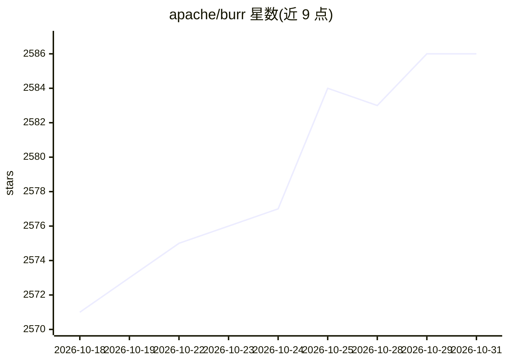

# apache/burr

⭐ 2,586 · Python · Apache-2.0 · 推送 2026-10-28 · [GitHub](https://github.com/apache/burr) · [官网](https://burr.apache.org/) · 组织维护

**以状态机构建决策型 LLM 应用的 Python 框架，含监控追踪 UI**

Apache 基金会孵化项目，提供无强制依赖的 Python 库，用简单函数与图/状态机表达应用逻辑，适用于 chatbot、agent、RAG、模拟等场景。内置遥测 UI 实时追踪执行，支持可插拔持久化存储保存/加载应用状态，并提供 Hamilton、streamlit 等集成。核心库兼容 Python 3.9，CLI 等可选组件需 3.10+。不规定模型构建、API 调用与数据管理方式，定位为把各环节串联起来的编排层。

## 筛选速览

| 维度 | 判定 | 备注 |
|---|---|---|
| AI 角色 | `ai-ecosystem` | LLM/agent 周边工具 |
| 许可风险 | `permissive` | Apache-2.0 |
| 部署形态 | `library` | 以包/库形式分发 |
| 模型依赖 | — | README 未给出锁定关系 |
| 硬件要求 | — | 无带数字的原话,不猜 |
| 安装摩擦 | `low` | 无编译、无系统依赖或容器化 |
| 成熟度 | — | 结构信号不足 |

## 能力要点

- 以状态机（图/流图）表达应用，用简单 Python 函数构建
- 内置遥测 UI 实时查看执行追踪
- 可插拔持久化器保存/加载应用状态
- 框架无关，可与任意 LLM 及常用库集成

## 适用场景

- 构建有状态的 chatbot 或 RAG 应用并追踪其决策过程
- 管理复杂决策流程、加入人工反馈或自持久化工作流
- 为 LLM 应用做监控、追踪与调试

## 场景标签

`Agent 框架` · 领域:Agent 开发

## 证据(README 行号)

> L60: With Apache Burr you express your application as a state machine (i.e. a graph/flowchart).
> L74: 1. A (dependency-free) low-abstraction python library that enables you to build and manage state machines with simp

## 星数曲线

2026-10-18 2,571 → 2026-10-31 2,586（+15）

---
*卡片 v1 · prompt 1.4 · 生成 2026-10-21 · 置信度 high · 依据 README sha `d206aaa9f6fa` · [字段定义](../../DATASET.md)*
