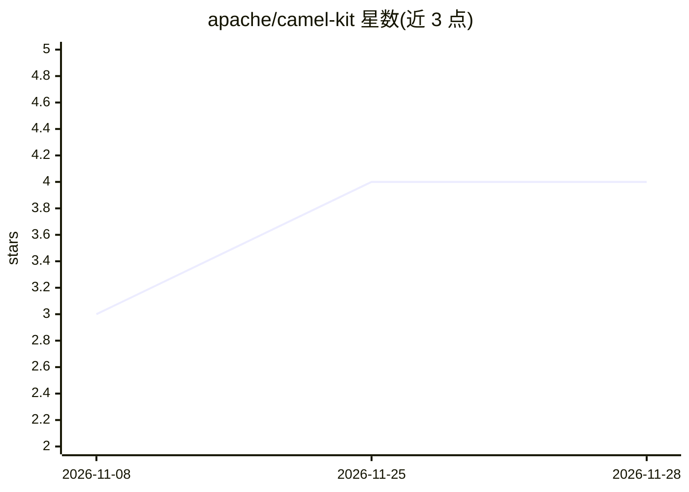

# apache/camel-kit

⭐ 4 · Java · NOASSERTION · 推送 2026-11-27 · [GitHub](https://github.com/apache/camel-kit) · [官网](https://camel.apache.org) · 组织维护

**给开发者的 Camel 集成 AI 辅助开发与文档检索工具集**

包含两个独立发布的产品：Kit 提供 CLI、agent skills、项目图与 Camel JBang 插件，向受支持的编码助手安装 /camel-start、/camel-brainstorm、/camel-plan、/camel-validate 等工作流，覆盖集成生命周期；Knowledge 是独立 MCP 服务器，用于搜索 Camel 文档、发布说明、CVE 公告与组件元数据，也可被不使用 Kit 的 MCP 客户端调用。从源码构建需 Java 21 及以上，使用 Maven wrapper。Ship 为 Technology Preview。

## 筛选速览

| 维度 | 判定 | 备注 |
|---|---|---|
| AI 角色 | `ai-ecosystem` | LLM/agent 周边工具 |
| 许可风险 | `none` | NOASSERTION |
| 部署形态 | `None` |  |
| 模型依赖 | — | README 未给出锁定关系 |
| 硬件要求 | — | 无带数字的原话,不猜 |
| 安装摩擦 | `medium` | 含编译或系统依赖之一 |
| 成熟度 | `idea` | |

## 能力要点

- Kit 向编码助手安装 /camel-start 至 /camel-knowledge 等工作流
- Knowledge MCP 服务器支持搜索文档、发布说明、CVE 公告与组件元数据
- Knowledge 含 embedding、索引器与已审核索引，支持索引版本锁定与失败回退
- Kit 与 Knowledge 独立版本发布，Kit 锁定经测试的 Knowledge 版本

## 适用场景

- 在编码助手中按工作流设计、实现并验证 Camel 集成
- 通过 MCP 客户端检索 Camel 文档与 CVE 公告
- 从源码构建并运行 Kit 与 Knowledge 服务器

## 场景标签

`编码 Agent` `RAG` · 领域:编码与开发

## 证据(README 行号)

> L3: Design, implement and verify Apache Camel integrations with AI coding assistants.
> L14: Kit installs workflows such as `/camel-start`, `/camel-brainstorm`, `/camel-plan`,

## 星数曲线

2026-11-08 3 → 2026-11-28 4（+1）

---
*卡片 v1 · prompt 1.4 · 生成 2026-11-22 · 置信度 mid · 依据 README sha `2be05f8ceda7` · [字段定义](../../DATASET.md)*
