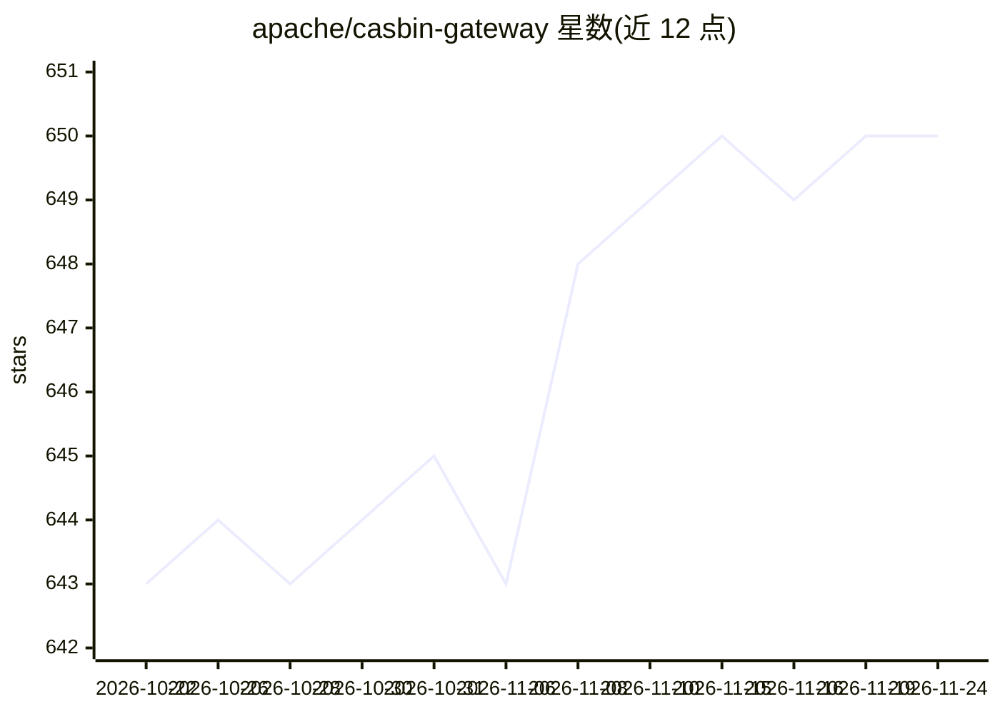

# apache/casbin-gateway

⭐ 652 · Go · Apache-2.0 · 推送 2026-11-23 · [GitHub](https://github.com/apache/casbin-gateway) · [官网](https://gateway.casbin.org) · 组织维护 · 中文 README

**本机 AI 编码 agent 的统一网关：监控、鉴真 API、管权限**

面向在同一台机器上使用多个 AI 编码 agent 的用户：把 Claude Code、Codex、Cursor 等约 30 个 agent 指向统一端点，覆盖 44 个模型厂商预设，支持故障时切换厂商、按 agent 配置权限（约 40 个开关，经 Casbin 编译为策略并在转发时执行）、从 agent 自身 transcripts 读取用量与提示记录、对上游 API 真伪做 A–F 评级，并可安装/升级/回滚 agent。一条命令安装，数据存本地 SQLite，默认仅服务本机、localhost:17000 提供 Web 界面。

## 筛选速览

| 维度 | 判定 | 备注 |
|---|---|---|
| AI 角色 | `ai-ecosystem` | LLM/agent 周边工具 |
| 许可风险 | `permissive` | Apache-2.0 |
| 部署形态 | `self-host` | docker 或自建部署 |
| 模型依赖 | local-ok | 支持本地模型 |
| 硬件要求 | — | 无带数字的原话,不猜 |
| 安装摩擦 | `low` | 无编译、无系统依赖或容器化 |
| 成熟度 | — | 结构信号不足 |

## 能力要点

- 一个端点覆盖 44 个模型厂商预设，支持 OpenAI/Anthropic 兼容 base URL
- 对每个上游 API 真伪直接探测并给出 A–F 评级
- 约 40 个 per-agent 权限开关，编译为 Casbin 策略并在每次转发请求时执行
- 从 agent 自身 transcripts 读取提示与花费，含未经代理的流量

## 适用场景

- 多个 AI 编码 agent 共用一套 API key 与厂商配置，集中切换
- 核验中转/经销商提供的 API 是否真的是宣称的模型
- 按 agent 限制可用工具、模型与厂商，并审计其提示与花费
- 某个厂商额度用尽或故障时自动转移到下一个厂商

## 场景标签

`模型网关` · 领域:Agent 开发

## 证据(README 行号)

> L96: - **Is that API key what it was sold as?** A reseller can serve a cheaper model, fake a cache hit, or quietly drop 
> L98: - **One place for all of them.** Point Claude Code, Codex, Cursor, Gemini CLI and the rest at any of 44 model vendo
> L199: - **Say what each agent may do** — around forty switches per agent, in groups, over its tools, models and provider

## 星数曲线

2026-10-22 643 → 2026-11-24 650（+7）

---
*卡片 v1 · prompt 1.4 · 生成 2026-11-24 · 置信度 mid · 依据 README sha `ad02d3806161` · [字段定义](../../DATASET.md)*
