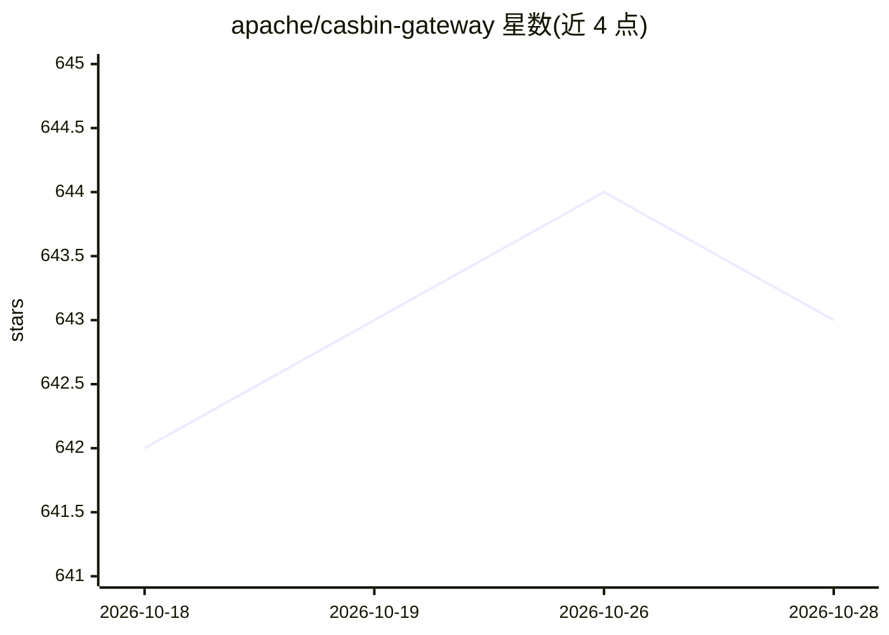

# apache/casbin-gateway

⭐ 643 · Go · Apache-2.0 · 推送 2026-10-22 · [GitHub](https://github.com/apache/casbin-gateway) · [官网](https://gateway.casbin.org) · 组织维护 · 中文 README

**本机 AI 编码 agent 的网关：监控、审计与统一接入 44 家模型厂商**

运行在本机的桌面/本地服务网关：把 Claude Code、Codex、Cursor、Gemini CLI 等 27 种 AI 编码 agent 指向统一端点，接入 44 家模型厂商或任意 OpenAI/Anthropic 兼容 base URL；用探针对上游 API 做真实性检验并给出 A–F 评级；基于 Casbin 策略对每个 agent 的工具、模型、供应商施加约 40 项权限开关；从 agent 自身的 transcript 读取用量与花费，记录完整请求；并支持安装、升级、回滚这些 agent。提供 Linux/macOS 与 Windows 一键脚本安装，数据存于本地 SQLite，无需数据库与额外运行时。

## 筛选速览

| 维度 | 判定 | 备注 |
|---|---|---|
| AI 角色 | `ai-ecosystem` | LLM/agent 周边工具 |
| 许可风险 | `permissive` | Apache-2.0 |
| 部署形态 | `self-host` | docker 或自建部署 |
| 模型依赖 | local-ok | 支持本地模型 |
| 硬件要求 | — | 无带数字的原话,不猜 |
| 安装摩擦 | `low` | 无编译、无系统依赖或容器化 |
| 成熟度 | — | 结构信号不足 |

## 能力要点

- 27 种编码 agent 统一接入，44 家模型厂商预设，跨厂商故障转移与模型路由
- 上游 API 真实性探针，按厂商独立评级 A–F
- 基于 Casbin 策略的每 agent 约 40 项权限开关，逐请求强制执行
- 从 agent 自身 transcript 读取用量/花费，记录完整提示词与工具 schema

## 适用场景

- 查看本机所有 AI 编码 agent 的行为、花费与提示记录
- 核验转售 API key 背后的模型是否货真价实
- 一处更换 API key 或 base URL，所有 agent 生效
- 集中安装、升级、回滚各编码 agent

## 场景标签

`模型网关` · 领域:Agent 开发

## 证据(README 行号)

> L98: - **One place for all of them.** Point Claude Code, Codex, Cursor, Gemini CLI and the rest at any of 44 model vendo
> L141: |Read from the transcripts the agents write themselves, so it counts what never went through Gateway too|44 vendor
> L198: - **Say what each agent may do** — around forty switches per agent, in groups, over its tools, models and provider

## 星数曲线

2026-10-18 642 → 2026-10-28 643（+1）

---
*卡片 v1 · prompt 1.4 · 生成 2026-10-21 · 置信度 mid · 依据 README sha `441e69633387` · [字段定义](../../DATASET.md)*
