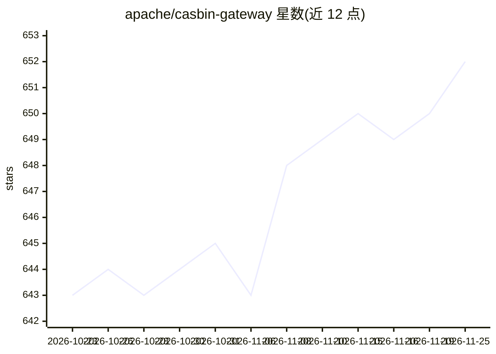

# apache/casbin-gateway

⭐ 652 · Go · Apache-2.0 · 推送 2026-11-23 · [GitHub](https://github.com/apache/casbin-gateway) · [官网](https://gateway.casbin.org) · 组织维护 · 中文 README

**本地网关：监控本机所有 AI 编码代理及其 API 真实性**

面向本机运行 AI 编码代理的开发者：一个本地网关统一接入 44 家模型供应商，代理读取代理自身的会话记录（transcript）统计提示词、工具调用与花费；向上游直接探测以 A–F 分级标注 API 真实性；以 Casbin 策略对每个代理的工具/模型/供应商权限做请求级强制；并在一个界面内完成各代理的安装、升级、回滚与配置迁移。单命令安装，无需数据库与编译，数据存本机 SQLite。

## 筛选速览

| 维度 | 判定 | 备注 |
|---|---|---|
| AI 角色 | `ai-ecosystem` | LLM/agent 周边工具 |
| 许可风险 | `permissive` | Apache-2.0 |
| 部署形态 | `self-host` | docker 或自建部署 |
| 模型依赖 | local-ok | 支持本地模型 |
| 硬件要求 | — | 无带数字的原话,不猜 |
| 安装摩擦 | `low` | 无编译、无系统依赖或容器化 |
| 成熟度 | — | 结构信号不足 |

## 能力要点

- 44 家供应商预设端点，一个 OpenAI/Anthropic 兼容 base URL 即可接入
- API 真实性探测：向上游直接验证并以 A–F 分级
- 约 40 项每代理权限开关，编译为 Casbin 策略在每次转发时执行
- 代理自身的安装/升级/回滚管理与跨代理 skills、MCP、prompt 复制

## 适用场景

- 核查购买的 API key 背后是否真的供应所宣称的模型
- 统一查看本机多个编码代理的花费、提示词与工具调用记录
- 一家供应商配额耗尽或宕机时自动切换到备用供应商
- 为不同代理分配不同的工具与模型使用权限

## 场景标签

`模型网关` · 领域:Agent 开发

## 证据(README 行号)

> L96: - **Is that API key what it was sold as?** A reseller can serve a cheaper model, fake a cache hit, or quietly drop 
> L98: - **One place for all of them.** Point Claude Code, Codex, Cursor, Gemini CLI and the rest at any of 44 model vendo
> L201: - **Say what each agent may do** — around forty switches per agent, in groups, over its tools, models and provider

## 星数曲线

2026-10-23 643 → 2026-11-25 652（+9）

---
*卡片 v1 · prompt 1.4 · 生成 2026-11-25 · 置信度 mid · 依据 README sha `a3e78d260e17` · [字段定义](../../DATASET.md)*
