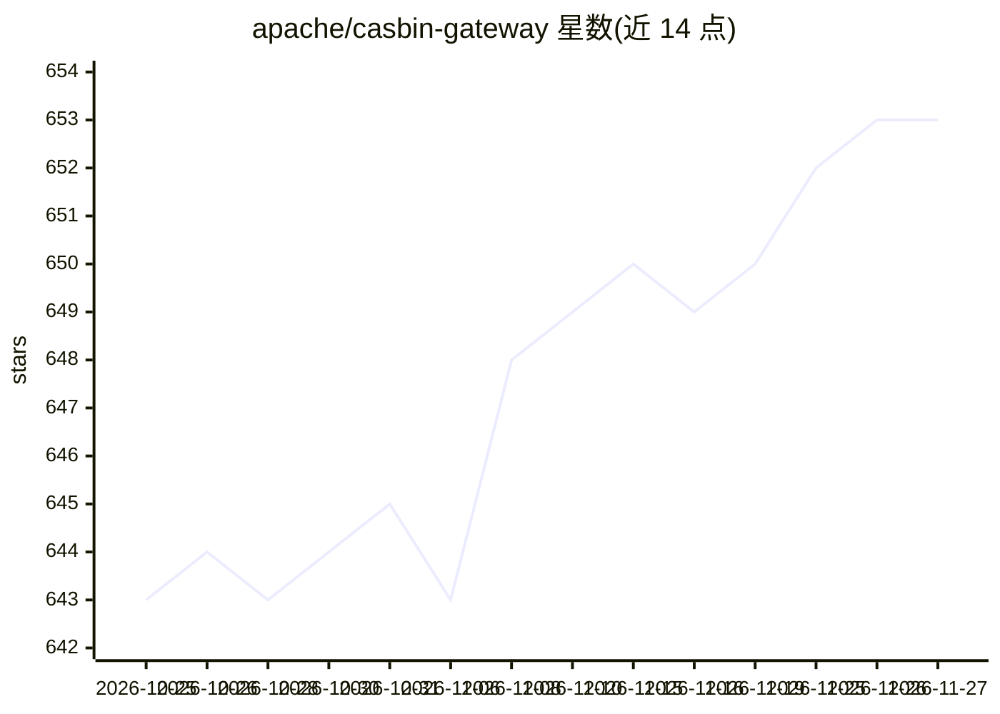

# apache/casbin-gateway

⭐ 653 · Go · Apache-2.0 · 推送 2026-11-25 · [GitHub](https://github.com/apache/casbin-gateway) · [官网](https://gateway.casbin.org) · 组织维护 · 中文 README

**本机 AI 编码 agent 的统一网关：监控用量、鉴真 API、管权限**

以 Go 编写的本机网关与桌面控制台，把 Claude Code、Codex、Cursor、Gemini CLI 等约 30 个编码 agent 的请求汇聚到统一端点，背后对接 44 家模型厂商预设或任意 OpenAI/Anthropic 兼容 base URL。核心机制：Authenticity 对上游直接探测并给出 A–F 分级；从 agent 自身 transcripts 读取 prompts、工具调用与花费；按 agent 配置约 40 个开关并编译为 Casbin 策略在每个转发请求上强制执行。单脚本安装，数据存本地 SQLite，无数据库/Go/Node 依赖。

## 筛选速览

| 维度 | 判定 | 备注 |
|---|---|---|
| AI 角色 | `ai-ecosystem` | LLM/agent 周边工具 |
| 许可风险 | `permissive` | Apache-2.0 |
| 部署形态 | `self-host` | docker 或自建部署 |
| 模型依赖 | local-ok | 支持本地模型 |
| 硬件要求 | — | 无带数字的原话,不猜 |
| 安装摩擦 | `low` | 无编译、无系统依赖或容器化 |
| 成熟度 | — | 结构信号不足 |

## 能力要点

- 44 家厂商预设统一端点，故障时跨厂商、跨 API 故障转移与模型路由
- Authenticity 探测上游并按 A–F 分级 API 真伪
- 按 agent 的工具/模型/厂商权限开关，编译为 Casbin 策略强制执行
- 从 agent 自身 transcripts 读取花费与记录，含未经过网关的流量

## 适用场景

- 核查某个中转 API key 背后是否真的卖给我所付的模型
- 统一管理本机多个编码 agent 的模型厂商、账号与版本升级回滚
- 为每个 agent 设定它能调用哪些工具、模型和厂商
- 统计各 agent 的 token 用量、缓存命中率与花费明细

## 场景标签

`模型网关` `编码 Agent` · 领域:Agent 开发

## 证据(README 行号)

> L2:  See what every AI coding agent on your machine is doing, and whether the API behind it is the one you paid for.
> L98: - **One place for all of them.** Point Claude Code, Codex, Cursor, Gemini CLI and the rest at any of 44 model vendo
> L201: - **Say what each agent may do** — around forty switches per agent, in groups, over its tools, models and provider

## 星数曲线

2026-10-25 643 → 2026-11-27 653（+10）

---
*卡片 v1 · prompt 1.4 · 生成 2026-11-26 · 置信度 mid · 依据 README sha `d07b4335e51f` · [字段定义](../../DATASET.md)*
