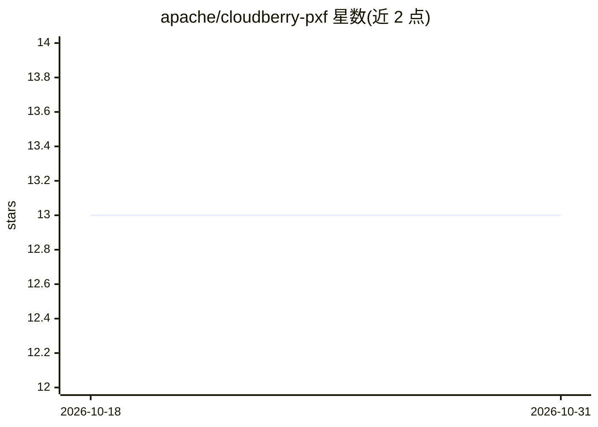

# apache/cloudberry-pxf

⭐ 13 · Java · Apache-2.0 · 推送 2026-10-26 · [GitHub](https://github.com/apache/cloudberry-pxf) · [官网](https://cloudberry.apache.org) · 组织维护

**让 Greenplum/Cloudberry 查询外部数据的扩展框架**

Apache Cloudberry 的平台扩展框架（源自 greenplum/pxf 定制），使分布式数据库能够查询数据库元数据未管理的外部数据文件。内置连接器覆盖 HDFS 文件、Hive 表、HBase 表与 JDBC 可访问数据库，用户可自建连接器。仓库含外部表协议处理器、FDW 扩展、服务端、CLI 与自动化测试。构建需 GCC、make、JDK 17/21、Go 1.25+ 及已安装的 Cloudberry，另提供含 Cloudberry/Hadoop/PXF 的 Docker 开发环境。

## 筛选速览

| 维度 | 判定 | 备注 |
|---|---|---|
| AI 角色 | `ai-ecosystem` | LLM/agent 周边工具 |
| 许可风险 | `permissive` | Apache-2.0 |
| 部署形态 | `library` | 以包/库形式分发 |
| 模型依赖 | — | README 未给出锁定关系 |
| 硬件要求 | — | 无带数字的原话,不猜 |
| 安装摩擦 | `high` | 编译与系统依赖俱全 |
| 成熟度 | — | 结构信号不足 |

## 能力要点

- 内置 HDFS/Hive/HBase/JDBC 连接器，可自建连接器
- 提供外部表协议处理器与 FDW 两种数据库扩展
- Docker 开发环境集成单节点 Hadoop、Cloudberry 与 PXF
- 提供 CLI（pxf prepare/start/restart）管理 PXF 服务

## 适用场景

- 在 Cloudberry/Greenplum 中以外部表或 FDW 方式查询数据湖数据
- 联邦查询 Hive/HBase/JDBC 数据库而无需导入数据
- 为本产品无内置连接器的存储引擎开发自定义连接器

## 场景标签

 · 领域:大数据/数据库基础设施

## 证据(README 行号)

> L13: PXF is an extensible framework that allows a distributed database like Greenplum and Apache Cloudberry to query ext
> L14: PXF includes built-in connectors for accessing data that exists inside HDFS files, Hive tables, HBase tables, JDBC-

## 星数曲线

2026-10-18 13 → 2026-10-31 13（+0）

---
*卡片 v1 · prompt 1.4 · 生成 2026-10-31 · 置信度 mid · 依据 README sha `42b248ff724e` · [字段定义](../../DATASET.md)*
