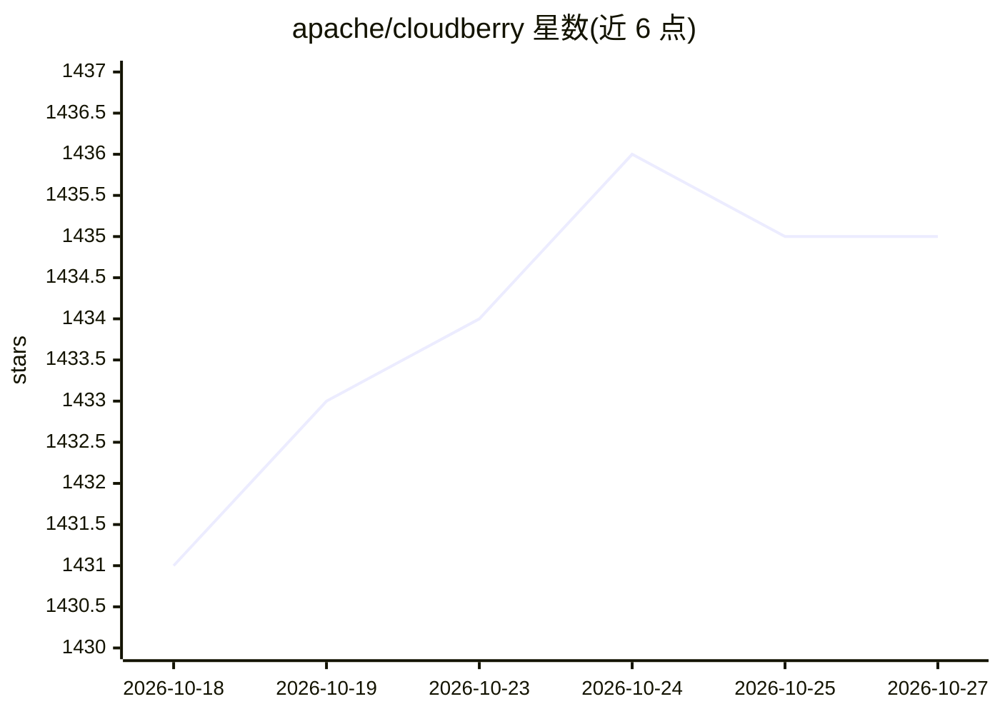

# apache/cloudberry

⭐ 1,435 · C · Apache-2.0 · 推送 2026-10-26 · [GitHub](https://github.com/apache/cloudberry) · [官网](https://cloudberry.apache.org) · 组织维护

**源自 Greenplum 原班开发者的开源 MPP 分析型数据库**

Apache 孵化中的大规模并行处理（MPP）数据库，由 Greenplum Database 原开发者创建，基于开源 Greenplum 演进，采用更新的 PostgreSQL 内核并增加企业能力。可作为数据仓库，支持大规模分析与 AI/ML 工作负载。提供 Linux（RHEL/Rocky、Ubuntu）与 macOS 的源码构建指南，另含 Docker 沙箱用于快速体验；主仓库之外有备份、PXF 扩展框架、连接器等生态仓库。采用 Apache License 2.0。

## 筛选速览

| 维度 | 判定 | 备注 |
|---|---|---|
| AI 角色 | `ai-enhanced` | 去掉 AI 部分产品仍成立 |
| 许可风险 | `permissive` | Apache-2.0 |
| 部署形态 | `None` |  |
| 模型依赖 | — | README 未给出锁定关系 |
| 硬件要求 | — | 无带数字的原话,不猜 |
| 安装摩擦 | `low` | 无编译、无系统依赖或容器化 |
| 成熟度 | — | 结构信号不足 |

## 能力要点

- 基于较新 PostgreSQL 内核的 MPP 架构，可作数据仓库
- 支持大规模分析与 AI/ML 工作负载
- 提供 Docker 沙箱快速体验与 Linux/macOS 源码构建指南
- 配套备份、PXF、go-libs 等生态仓库

## 适用场景

- 搭建大规模并行分析型数据仓库
- 承载大数据 OLAP 分析与 AI/ML 工作负载
- 从 Greenplum 生态迁移或延续使用场景

## 场景标签

 · 领域:数据库/大数据

## 证据(README 行号)

> L28: Apache Cloudberry (Incubating), created by the original developers of
> L32: advanced enterprise capabilities. It can serve as a data warehouse and can

## 星数曲线

2026-10-18 1,431 → 2026-10-27 1,435（+4）

---
*卡片 v1 · prompt 1.4 · 生成 2026-10-21 · 置信度 high · 依据 README sha `5f87ce300a24` · [字段定义](../../DATASET.md)*
