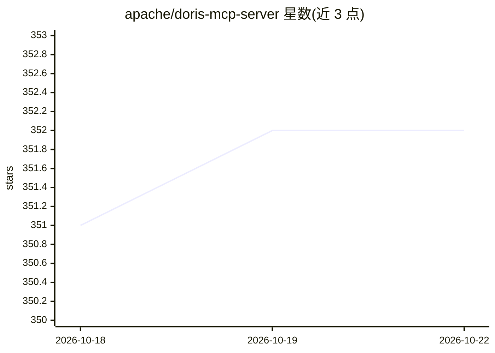

# apache/doris-mcp-server

⭐ 352 · Python · Apache-2.0 · 推送 2026-10-20 · [GitHub](https://github.com/apache/doris-mcp-server) · [官网](https://doris.apache.org) · 组织维护

**向 AI agent 只读暴露 Apache Doris 能力的 MCP 服务器**

Apache Doris 官方的 MCP Server，通过 stdio 或 Streamable HTTP 向 MCP Host 和 AI agent 提供对 Doris 的只读访问。1.0 版将工具组织为 8 个稳定域、55 个渐进披露子能力，覆盖查询、集群运维、数据摄取、文本/向量/混合搜索、治理、湖仓与语义层（可选 Ossie grounding 与 MetricFlow）。安全上强制只读、支持静态令牌/JWT/OAuth 认证，Doris RBAC 为最终权限边界；协议兼容 GA 但 Python 包分类仍为 Beta。需 Python 3.12+ 与 Doris 2.0.0+，pip 安装。

## 筛选速览

| 维度 | 判定 | 备注 |
|---|---|---|
| AI 角色 | `ai-ecosystem` | LLM/agent 周边工具 |
| 许可风险 | `permissive` | Apache-2.0 |
| 部署形态 | `library` | 以包/库形式分发 |
| 模型依赖 | — | README 未给出锁定关系 |
| 硬件要求 | — | 无带数字的原话,不猜 |
| 安装摩擦 | `low` | 无编译、无系统依赖或容器化 |
| 成熟度 | `idea` | |

## 能力要点

- 8 个工具域、55 个渐进披露子能力，支持 flat 模式回退
- 只读安全边界：静态令牌/JWT/OAuth/OIDC 认证与输出限额
- Streamable HTTP 与 stdio 双传输，含旧版 HTTP 适配器（如 Dify 兼容）
- 可选 MetricFlow 语义层与 Ossie grounding 集成

## 适用场景

- 让 AI agent 通过 MCP 查询和诊断 Doris 数据库
- 在 MCP Host 中接入 Doris 的目录、查询、集群与治理能力
- 湖仓场景下让 agent 检索外部 catalog 与执行文本/向量搜索

## 场景标签

`数据分析` · 领域:效率与自动化

## 证据(README 行号)

> L5: Apache Doris MCP Server exposes read-only Apache Doris capabilities to MCP
> L26: MCP Host

## 星数曲线

2026-10-18 351 → 2026-10-22 352（+1）

---
*卡片 v1 · prompt 1.4 · 生成 2026-10-21 · 置信度 high · 依据 README sha `89efd8a942af` · [字段定义](../../DATASET.md)*
