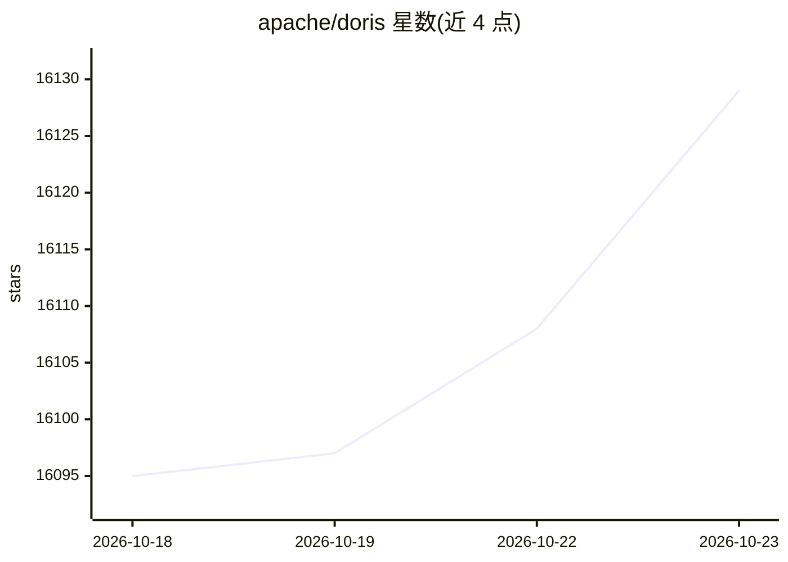

# apache/doris

⭐ 16,129 · Java · Apache-2.0 · 推送 2026-10-22 · [GitHub](https://github.com/apache/doris) · [官网](https://doris.apache.org) · 组织维护

**面向实时分析与混合搜索场景的 MPP 架构分析型数据库**

基于 MPP 架构的开源实时分析与搜索数据库，提供三条核心能力线：支持流式摄入与高并发亚秒查询的实时分析、基于 Iceberg/Delta Lake/Hudi 等开放表格式的湖仓查询加速、以及覆盖 JSON、全文与向量数据的混合搜索。支持存算一体与存算分离两种部署形态，提供 Flink/Spark/Kafka 连接器与 Kubernetes Operator。README 未含安装命令细节，安装与编译指引在官网文档中。

## 筛选速览

| 维度 | 判定 | 备注 |
|---|---|---|
| AI 角色 | `ai-enhanced` | 去掉 AI 部分产品仍成立 |
| 许可风险 | `permissive` | Apache-2.0 |
| 部署形态 | `None` |  |
| 模型依赖 | — | README 未给出锁定关系 |
| 硬件要求 | — | 无带数字的原话,不猜 |
| 安装摩擦 | `medium` | 含编译或系统依赖之一 |
| 成熟度 | — | 结构信号不足 |

## 动量与使用信号

- 维护:`active` — 距上次 push 0.8 天,年发版 18,329 位贡献者
- 涨星:近 1 天 **+5**(自 20261016 起算)
- 安装:github 包 `release-assets` 月下载无数据

## 能力要点

- MPP 架构下的实时分析：流式摄入、增量转换、高并发亚秒查询
- 湖仓分析：对 Iceberg、Delta Lake、Hudi 开放表格式做 SQL 加速
- 混合搜索：同一 SQL 引擎内查询向量、文本、JSON 与结构化数据
- 支持存算耦合与存算分离部署，分离模式下计算组运行于共享对象存储

## 适用场景

- 面向外部用户交付亚秒级交互式分析应用
- 搭建跨业务域的实时数据仓库
- 用 SQL 分析高吞吐日志、事件与指标
- 在单一 SQL 引擎中做面向 AI 的向量与文本检索

## 场景标签

 · 领域:数据基础设施/分析型数据库

## 证据(README 行号)

> L24: Apache Doris is an open-source, real-time analytics and search database built on MPP architecture. It provides fast
> L35: |Doris for AI|Use vector, text, JSON, and structured search in one SQL engine.|
> L43: |Real-Time Analytics|Streaming ingestion, incremental transformation, and sub-second queries under high concurrency
> L65: Apache Doris supports both compute-storage coupled and compute-storage decoupled deployments. In decoupled mode, st

## 星数曲线

2026-10-18 16,095 → 2026-10-23 16,129（+34）

---
*卡片 v1 · prompt 1.4 · 生成 2026-10-18 · 置信度 high · 依据 README sha `0d96178d7695` · [字段定义](../../DATASET.md)*
