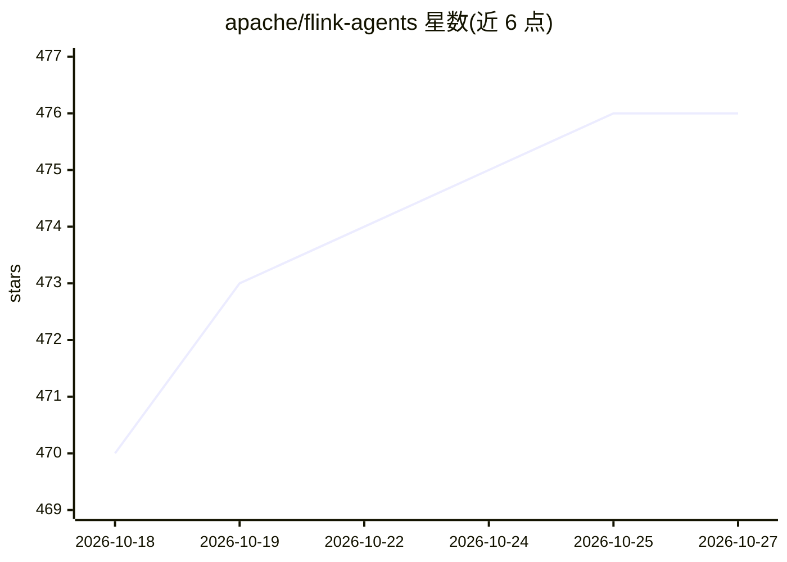

# apache/flink-agents

⭐ 476 · Java · Apache-2.0 · 推送 2026-10-26 · [GitHub](https://github.com/apache/flink-agents) · [官网](https://nightlies.apache.org/flink/flink-agents-docs-main/) · 组织维护

**基于 Apache Flink 的 Agentic AI 框架，供分布式场景构建多 agent**

Apache 基金会孵化项目，在 Apache Flink 之上提供构建 Agentic AI 应用的框架，主题标签标注支持多 agent、事件驱动、实时与分布式场景，并提供 Python 与 Java 双语言构建。README 仅含构建说明：需 Unix-like 环境、Git、Maven、Java 11+ 与 Python 3（3.10-3.12），通过 git clone 源码后执行 ./tools/build.sh 同时构建 Java 与 Python 部分，并将 dist jar 打入 Python wheel 包。文档与功能细节以外部 User Documentation 链接给出。

## 筛选速览

| 维度 | 判定 | 备注 |
|---|---|---|
| AI 角色 | `ai-ecosystem` | LLM/agent 周边工具 |
| 许可风险 | `permissive` | Apache-2.0 |
| 部署形态 | `None` |  |
| 模型依赖 | — | README 未给出锁定关系 |
| 硬件要求 | — | 无带数字的原话,不猜 |
| 安装摩擦 | `medium` | 含编译或系统依赖之一 |
| 成熟度 | — | 结构信号不足 |

## 能力要点

- 基于 Apache Flink 的 Agentic AI 框架
- Java 与 Python 双语言构建，dist jar 打入 wheel 包
- 提供源码构建脚本 ./tools/build.sh

## 适用场景

- 在 Flink 流处理基础设施上构建事件驱动的多 agent 应用
- 需要 Java/Python 双栈的分布式 agentic AI 开发
- 参与 Apache 基金会社区共建与每周社区同步会

## 场景标签

`Agent 框架` `多智能体` · 领域:Agent 开发

## 证据(README 行号)

> L3: Apache Flink Agents is an Agentic AI framework based on Apache Flink.

## 星数曲线

2026-10-18 470 → 2026-10-27 476（+6）

---
*卡片 v1 · prompt 1.4 · 生成 2026-10-21 · 置信度 high · 依据 README sha `82a9a7061c68` · [字段定义](../../DATASET.md)*
