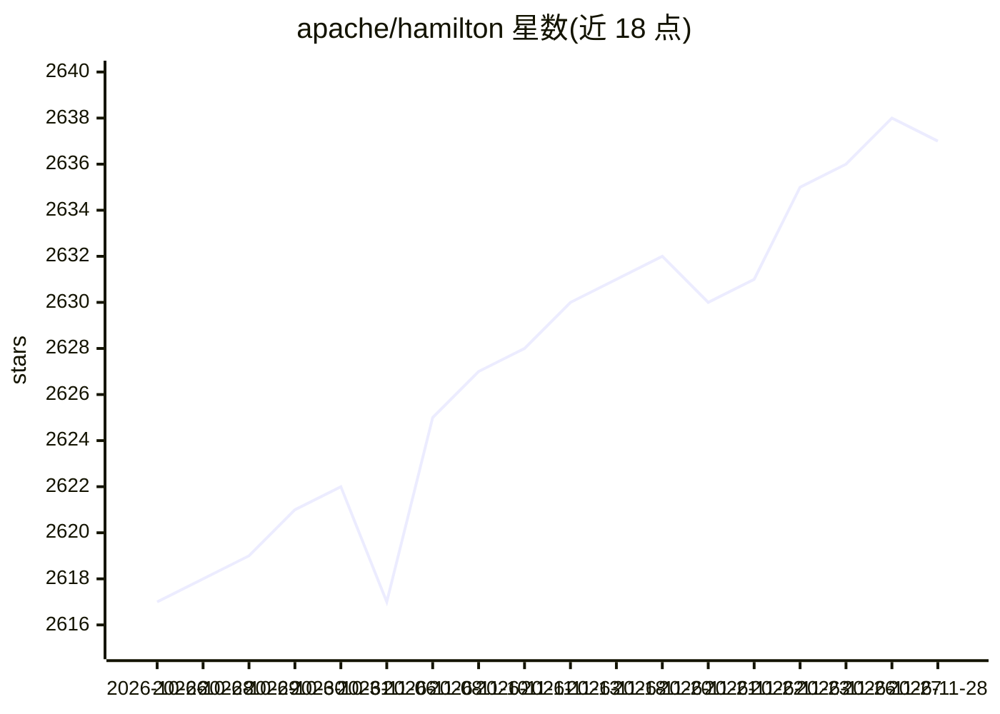

# apache/hamilton

⭐ 2,637 · Jupyter Notebook · Apache-2.0 · 推送 2026-11-27 · [GitHub](https://github.com/apache/hamilton) · [官网](https://hamilton.apache.org/) · 组织维护

**给数据科学家/工程师的 Python 数据转换 DAG 框架**

Apache Hamilton（孵化中）是一个轻量 Python 库，用于定义数据转换的有向无环图（DAG）：用户编写普通 Python 函数并以参数声明依赖，库自动构建 DAG，附带血缘追踪与元数据。DAG 可移植到脚本、notebook、Airflow、FastAPI 等任何 Python 运行环境；通过函数修饰器支持数据/schema 校验、环境切换（@config.when）等执行控制。附带 Hamilton UI 用于可视化、数据目录与执行监控，可本地或 Docker 自托管。支持 Python 3.11+，Apache 2.0 许可。

## 筛选速览

| 维度 | 判定 | 备注 |
|---|---|---|
| AI 角色 | `ai-ecosystem` | LLM/agent 周边工具 |
| 许可风险 | `permissive` | Apache-2.0 |
| 部署形态 | `library` | 以包/库形式分发 |
| 模型依赖 | — | README 未给出锁定关系 |
| 硬件要求 | — | 无带数字的原话,不猜 |
| 安装摩擦 | `low` | 无编译、无系统依赖或容器化 |
| 成熟度 | `idea` | |

## 能力要点

- 用普通 Python 函数声明依赖，自动构建 DAG 并可可视化
- DAG 与基础设施解耦，可运行于脚本/notebook/Airflow/FastAPI
- @check_output 与 SchemaValidator 做数据与 schema 校验
- Hamilton UI 提供数据目录、血缘追踪与执行监控

## 适用场景

- 为 ETL 管道与特征工程代码建立模块化、可测试的结构
- 给 LLM 应用或 RAG 系统的数据流加上血缘与追踪
- 在本地开发调试后复用同一套 DAG 到 Airflow/FastAPI 生产环境
- 用 UI 对团队的 DAG 执行做目录化与故障排查

## 场景标签

`MLOps` · 领域:训练与推理

## 证据(README 行号)

> L32: Apache Hamilton (incubating) is a lightweight Python library for directed acyclic graphs (DAGs) of data transformat
> L40: Apache Hamilton brings modularity and structure to any Python application moving data: ETL pipelines, ML workflows,

## 星数曲线

2026-10-26 2,617 → 2026-11-28 2,637（+20）

---
*卡片 v1 · prompt 1.4 · 生成 2026-11-24 · 置信度 high · 依据 README sha `57f5dbde0de5` · [字段定义](../../DATASET.md)*
