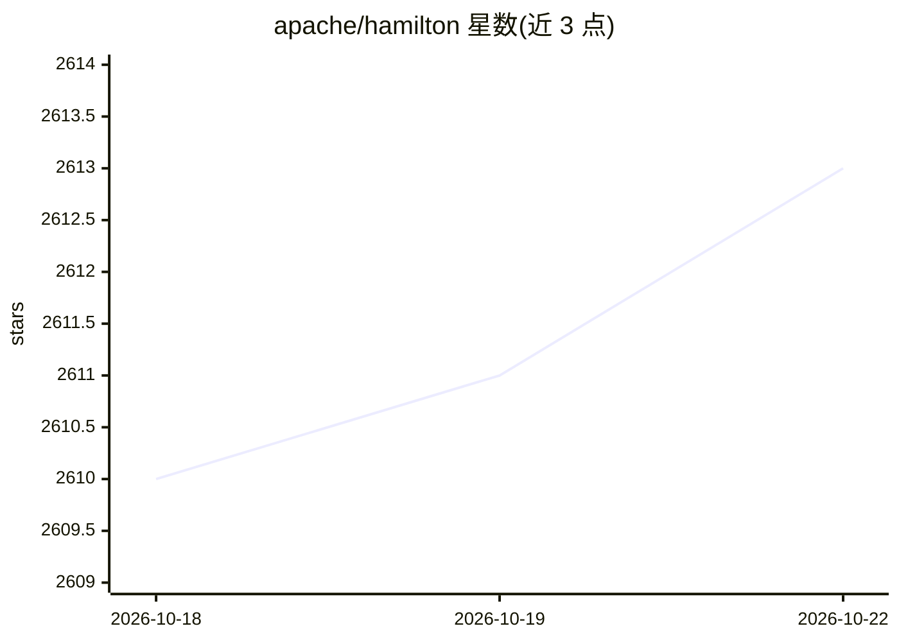

# apache/hamilton

⭐ 2,615 · Jupyter Notebook · Apache-2.0 · 推送 2026-10-21 · [GitHub](https://github.com/apache/hamilton) · [官网](https://hamilton.apache.org/) · 组织维护

**数据科学家/工程师：用 Python 函数定义可移植、可测试的数据变换 DAG**

轻量级 Python 库，通过普通 Python 函数参数声明依赖，自动构建数据变换 DAG。DAG 定义与执行分离，可在脚本、notebook、Airflow、FastAPI 等任何 Python 运行环境执行；提供数据/模式校验、@config.when() 环境切换、函数修饰器、Apache Hamilton UI（数据目录、lineage/追踪、执行监控，可本地或 Docker 自托管）。适用 ETL、ML 工作流、LLM 应用与 RAG 系统等场景。非编排器、非特征存储。当前为 Apache 孵化项目，2019 年起用于生产环境。

## 筛选速览

| 维度 | 判定 | 备注 |
|---|---|---|
| AI 角色 | `ai-ecosystem` | LLM/agent 周边工具 |
| 许可风险 | `permissive` | Apache-2.0 |
| 部署形态 | `library` | 以包/库形式分发 |
| 模型依赖 | — | README 未给出锁定关系 |
| 硬件要求 | — | 无带数字的原话,不猜 |
| 安装摩擦 | `low` | 无编译、无系统依赖或容器化 |
| 成熟度 | `idea` | |

## 能力要点

- Python 函数即节点，自动构建 DAG，代码可单元测试
- DAG 可移植：本地开发代码可在 Airflow/FastAPI 等环境复用
- @check_output 与 SchemaValidator 支持 pandas/polars/Ibis 等模式校验
- Apache Hamilton UI 提供数据目录、lineage 与执行追踪

## 适用场景

- 把 pandas 数据处理代码组织为可测试、可视化的生产管线
- 跨环境（notebook→Airflow/FastAPI）复用同一套变换代码
- 为 ETL/ML/RAG 管线提供执行观测与数据溯源

## 场景标签

`MLOps` · 领域:训练与推理

## 证据(README 行号)

> L32: Apache Hamilton (incubating) is a lightweight Python library for directed acyclic graphs (DAGs) of data transformat
> L40: Apache Hamilton brings modularity and structure to any Python application moving data: ETL pipelines, ML workflows,

## 星数曲线

2026-10-18 2,610 → 2026-10-22 2,613（+3）

---
*卡片 v1 · prompt 1.4 · 生成 2026-10-21 · 置信度 high · 依据 README sha `b8160c9d1c58` · [字段定义](../../DATASET.md)*
