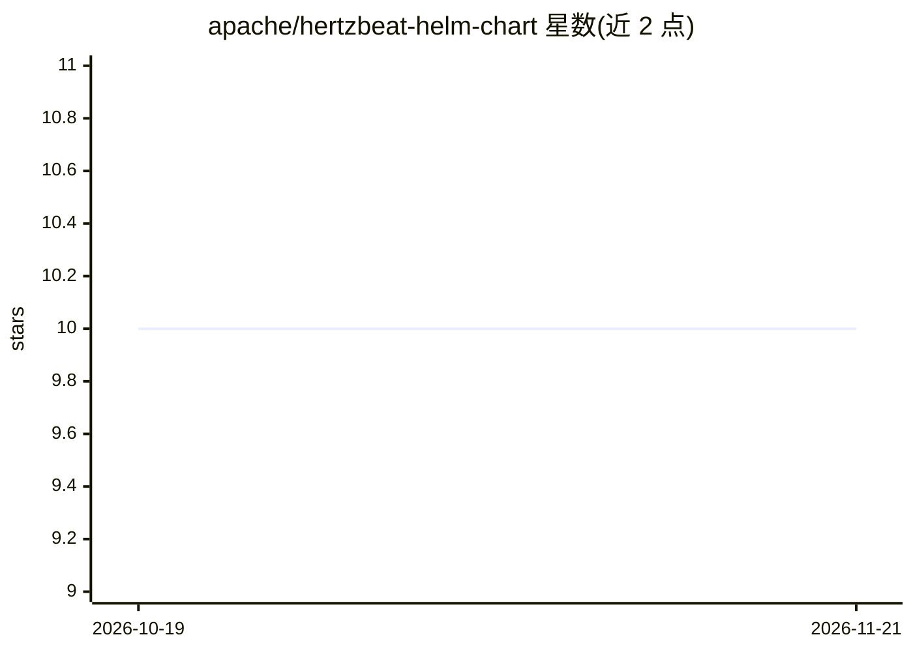

# apache/hertzbeat-helm-chart

⭐ 10 · Go Template · Apache-2.0 · 推送 2026-08-17 · [GitHub](https://github.com/apache/hertzbeat-helm-chart) · [官网](https://hertzbeat.apache.org/) · 组织维护 · 中文 README

**Helm Chart：在 Kubernetes 集群部署 HertzBeat 实时监控系统**

本仓库提供 Apache HertzBeat 的 Helm Chart，用于在 Kubernetes 1.20+ 集群中一键安装 HertzBeat。HertzBeat 自述为 AI 驱动的开源实时可观测系统，整合指标与日志采集、告警分发、通知推送与状态页构建，无 Agent 架构，兼容 Prometheus 协议，内置 MCP Server 能力。Chart 支持通过 values.yaml 或 --set 配置服务暴露方式（Ingress/ClusterIP/NodePort/LoadBalancer）、数据持久化、采集器副本数与自动扩缩等参数，chart 内含 manager、collector、database、TSDB 等组件的资源配置。

## 筛选速览

| 维度 | 判定 | 备注 |
|---|---|---|
| AI 角色 | `ai-enhanced` | 去掉 AI 部分产品仍成立 |
| 许可风险 | `permissive` | Apache-2.0 |
| 部署形态 | `library` | 以包/库形式分发 |
| 模型依赖 | — | README 未给出锁定关系 |
| 硬件要求 | — | 无带数字的原话,不猜 |
| 安装摩擦 | `low` | 无编译、无系统依赖或容器化 |
| 成熟度 | — | 结构信号不足 |

## 能力要点

- helm install 一条命令在 K8s 集群部署 HertzBeat
- 支持 Ingress/ClusterIP/NodePort/LoadBalancer 四种服务暴露方式
- PVC 数据持久化配置，默认 5Gi 存储
- collector 副本数与自动扩缩配置项

## 适用场景

- 在 Kubernetes 集群里部署 HertzBeat 统一监控平台
- 通过 Helm values 定制采集器副本与资源配额
- 配置持久化存储保留监控与告警数据

## 场景标签

 · 领域:运维监控/可观测性

## 证据(README 行号)

> L9: Apache HertzBeat™ is an AI-powered next-generation open source real-time observability system. Unified metrics and l
> L13: - Integrates **collection + analysis + alerting + notification** into one platform, with new AI-powered interaction
> L26: This Helm chart installs HertzBeat in a Kubernetes cluster. Welcome to contribute to Helm Chart for HertzBeat.

## 星数曲线

2026-10-19 10 → 2026-11-21 10（+0）

---
*卡片 v1 · prompt 1.4 · 生成 2026-11-20 · 置信度 high · 依据 README sha `351707c6e7a2` · [字段定义](../../DATASET.md)*
