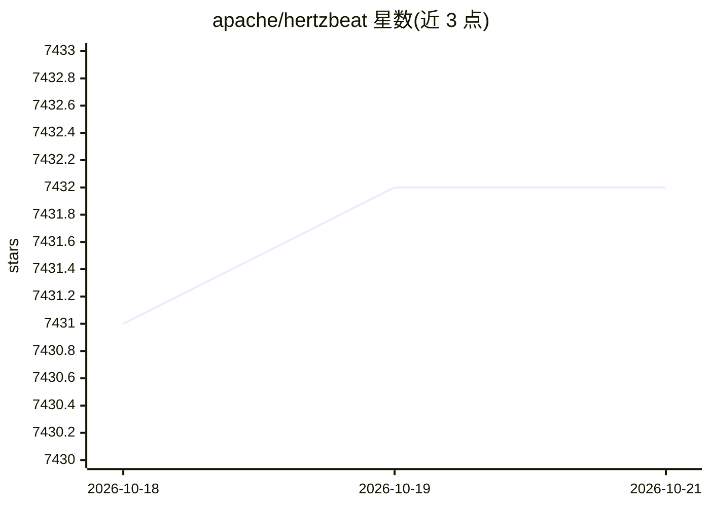

# apache/hertzbeat

⭐ 7,432 · Java · Apache-2.0 · 推送 2026-10-19 · [GitHub](https://github.com/apache/hertzbeat) · [官网](https://hertzbeat.apache.org/) · 组织维护 · 中文 README

**Apache 开源实时可观测系统：指标日志采集、告警与状态页**

面向运维与开发者的实时可观测平台，集采集、分析、告警、通知于一体：无 Agent 模式统一采集指标（Prometheus 兼容）与日志（OTLP 协议），支持通过在线配置 YML 模板自定义监控，告警可经 Email、Discord、Slack、钉钉等多渠道分发，并内置状态页构建能力。HertzBeat AI 提供智能交互与 MCP Server 能力。部署方式覆盖 Docker、安装包、源码、docker-compose 与 Kubernetes Helm，支持 x86/arm64 与采集器集群横向扩展。

## 筛选速览

| 维度 | 判定 | 备注 |
|---|---|---|
| AI 角色 | `ai-enhanced` | 去掉 AI 部分产品仍成立 |
| 许可风险 | `permissive` | Apache-2.0 |
| 部署形态 | `self-host` | docker 或自建部署 |
| 模型依赖 | — | README 未给出锁定关系 |
| 硬件要求 | — | 无带数字的原话,不猜 |
| 安装摩擦 | `low` | 无编译、无系统依赖或容器化 |
| 成熟度 | `idea` | |

## 能力要点

- 无 Agent 统一采集指标（Prometheus 兼容）与日志（OTLP）
- 通过在线配置 YML 模板自定义监控类型（Http/Jmx/Ssh/Snmp/Jdbc 等）
- 告警多渠道分发（Email/Discord/Slack/钉钉/飞书/短信/Webhook 等）
- 多采集器集群横向扩展与云边协同、状态页构建

## 适用场景

- 统一监控应用、数据库、中间件与云原生环境的指标和日志
- 集中管理多来源告警并通过多渠道分发
- 搭建面向用户的服务实时状态页

## 场景标签

 · 领域:运维/可观测性

## 证据(README 行号)

> L21: Apache HertzBeat™ is an AI-powered next-generation open source real-time observability system. Unified metrics and 
> L25: - Integrates **collection + analysis + alerting + notification** into one platform, with new AI-powered interaction

## 星数曲线

2026-10-18 7,431 → 2026-10-21 7,432（+1）

---
*卡片 v1 · prompt 1.4 · 生成 2026-10-20 · 置信度 high · 依据 README sha `fd4cf17511a9` · [字段定义](../../DATASET.md)*
