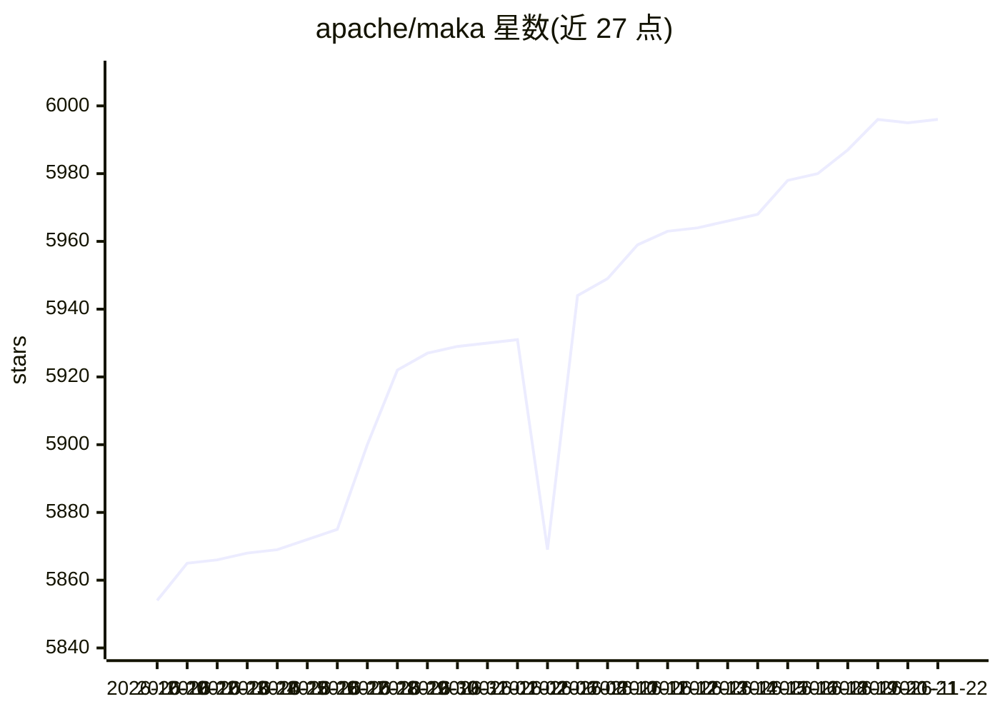

# apache/maka

⭐ 5,996 · TypeScript · Apache-2.0 · 推送 2026-11-21 · [GitHub](https://github.com/apache/maka) · 组织维护 · 中文 README

**本地优先的 agent 工作区：完整记录执行的每一步**

Apache 孵化项目，提供运行 AI agent 的工作区，核心机制是 append-only 的 RuntimeEvent 日志：模型消息、工具调用、权限决策与终止均入日志，UI、下一条提示与崩溃恢复都由该日志投影生成。会话、设置与运行记录留在本地，模型由用户自接（云 API、本地模型或兼容网关）。桌面版基于 Electron，另有 TUI 与 CLI 入口，三者共享同一 Runtime Host；支持中断回合恢复与 Graph 多切片任务。平台为 macOS（Windows/Linux 为 preview）。

## 筛选速览

| 维度 | 判定 | 备注 |
|---|---|---|
| AI 角色 | `ai-ecosystem` | LLM/agent 周边工具 |
| 许可风险 | `permissive` | Apache-2.0 |
| 部署形态 | `None` |  |
| 模型依赖 | — | README 未给出锁定关系 |
| 硬件要求 | — | 无带数字的原话,不猜 |
| 安装摩擦 | `low` | 无编译、无系统依赖或容器化 |
| 成熟度 | `idea` | |

## 能力要点

- 所有模型消息、工具调用与权限决策以 append-only RuntimeEvent 记录
- 本地优先：会话与凭据存于本机，用户自带模型接入（API/本地模型/网关）
- Desktop、TUI、CLI 与 Eval 共享一个 Runtime Host 执行权威
- 支持中断回合恢复与 /graph 多切片任务（隔离 Git worktree）

## 适用场景

- 本地运行 agent 完成编码或仓库分析任务并留存完整执行记录
- 接入自己的云 API 或本地模型做 agent 任务
- 对 agent 运行做基准评测（同模型同验证器对比 harness）
- 崩溃或中断后恢复未完成的回合

## 场景标签

`编码 Agent` `Agent 框架` `模型评测` · 领域:Agent 开发

## 证据(README 行号)

> L14:  One turn of RuntimeEvents: the model speaks, runs a command, asks permission, you approve, it gets the result, edi
> L21: - **The log is the runtime.** Every model message, tool call, permission decision and termination is an append-only
> L22: - **Your machine, your model.** Sessions, settings and run records stay local. You bring the model: a cloud API, a 

## 星数曲线

2026-10-20 5,854 → 2026-11-22 5,996（+142）

---
*卡片 v1 · prompt 1.4 · 生成 2026-11-22 · 置信度 high · 依据 README sha `dc7bca4c483e` · [字段定义](../../DATASET.md)*
