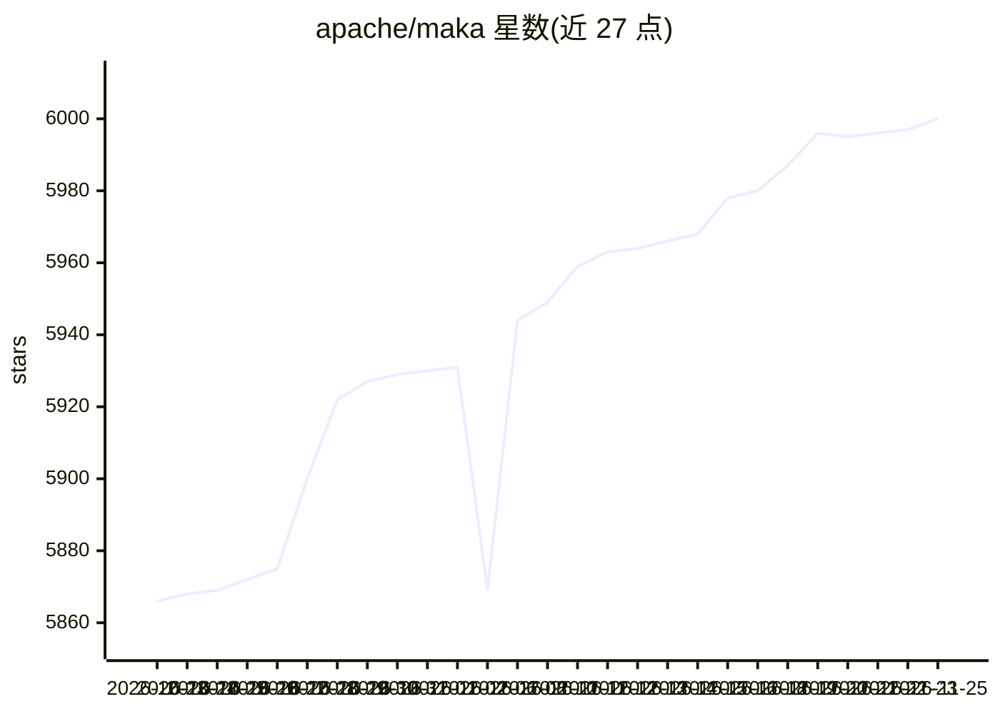

# apache/maka

⭐ 6,000 · Rust · Apache-2.0 · 推送 2026-11-24 · [GitHub](https://github.com/apache/maka) · 组织维护 · 中文 README

**本地优先的终端/桌面 agent 工作区，记录每次运行与审批**

Apache 基金会孵化项目，提供终端与桌面两种外壳的 agent 工作区。Rust 编写的后台 Host 进程统一负责模型执行、沙箱（V8/Python）、权限管理与 SQLite 状态，以事件溯源方式记录每次运行、审批与工具回执。仓库含插件内核、agent 运行时、NSH 工作台 UI、ACP server、Harbor 评测容器与插件 SDK；通过 git clone + just 构建运行，亦可经 npm 包装器分发平台原生二进制。

## 筛选速览

| 维度 | 判定 | 备注 |
|---|---|---|
| AI 角色 | `ai-ecosystem` | LLM/agent 周边工具 |
| 许可风险 | `permissive` | Apache-2.0 |
| 部署形态 | `desktop` | 安装包/桌面程序 |
| 模型依赖 | — | README 未给出锁定关系 |
| 硬件要求 | — | 无带数字的原话,不猜 |
| 安装摩擦 | `low` | 无编译、无系统依赖或容器化 |
| 成熟度 | — | 结构信号不足 |

## 能力要点

- Rust Runtime Host 统一管理模型执行、沙箱、权限与 SQLite 状态
- 事件溯源记录每次运行、审批与工具回执
- 终端与桌面外壳共用同一 Host 进程与 NSH 工作台 UI
- 插件 SDK（TypeScript 契约）支持扩展 Host 与 UI

## 适用场景

- 在本地终端或桌面运行 agent 任务并保留完整审计记录
- 对 agent 运行做权限控制与沙箱隔离
- 通过容器化 Harbor 评测运行器对 Host 做评估

## 场景标签

`Agent 框架` `模型评测` · 领域:Agent 开发

## 证据(README 行号)

> L5: Apache Maka (Incubating) is a local-first agent workspace for the terminal and desktop. A background Rust Runtime Ho
> L36: |plugins/|Agent runtime, workspace tools, skills, settings, interactions, and shared domain contracts|
> L52: Apache Maka is an effort undergoing incubation at The Apache Software Foundation (ASF). See DISCLAIMER, LICENSE, an

## 星数曲线

2026-10-23 5,866 → 2026-11-25 6,000（+134）

---
*卡片 v1 · prompt 1.4 · 生成 2026-11-23 · 置信度 high · 依据 README sha `fbdacbae72ae` · [字段定义](../../DATASET.md)*
