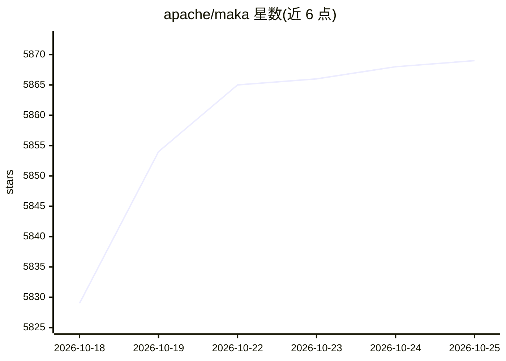

# apache/maka

⭐ 5,872 · TypeScript · Apache-2.0 · 推送 2026-10-25 · [GitHub](https://github.com/apache/maka) · 组织维护 · 中文 README

**Apache 孵化中的本地优先 agent 工作区，完整记录 agent 运行全程**

面向使用 AI agent 完成任务的用户的高性能 agent 工作区（Apache 孵化项目），提供 Electron 桌面端、TUI 与 CLI 三种客户端形态。核心机制：所有模型消息、工具调用、权限决策以 append-only 的 RuntimeEvent 事件日志持久化到本地 SQLite，UI、后续 prompt 与崩溃恢复均为日志投影；三端共享同一 Runtime Host 执行体。模型由用户自带（云 API、本地模型或兼容网关），会话与凭据保存在本地。README 声明以官方 verifier 的基准结果衡量任务完成情况，结果发布于 docs/eval/。构建需 Node.js 22/24 与 ripgrep。

## 筛选速览

| 维度 | 判定 | 备注 |
|---|---|---|
| AI 角色 | `ai-ecosystem` | LLM/agent 周边工具 |
| 许可风险 | `permissive` | Apache-2.0 |
| 部署形态 | `None` |  |
| 模型依赖 | — | README 未给出锁定关系 |
| 硬件要求 | — | 无带数字的原话,不猜 |
| 安装摩擦 | `low` | 无编译、无系统依赖或容器化 |
| 成熟度 | `idea` | |

## 能力要点

- 模型消息、工具调用、权限决策全部记录为 append-only RuntimeEvent 日志，存于本地 runtime.sqlite
- 桌面端、TUI、CLI 与 Eval 共用一个 Runtime Host 执行体
- 模型自带（云 API / 本地模型 / 兼容网关），会话与密钥保存在本地
- 支持中断 Turn 的显式恢复（Desktop 与 CLI/TUI /resume）

## 适用场景

- 在桌面或终端里驱动 agent 完成编码等任务并保留完整可审计记录
- 崩溃或中断后从事件日志恢复继续执行
- 用同一工具在不同模型接入方式下对比运行 agent 任务

## 场景标签

`Agent 框架` `编码 Agent` · 领域:Agent 开发

## 证据(README 行号)

> L3:  Apache Maka (Incubating) is a high-performance agent workspace that keeps a complete record of everything it did.
> L22: - **Your machine, your model.** Sessions, settings and run records stay local. You bring the model: a cloud API, a 
> L119: Desktop / TUI / CLI → Runtime Host → SessionManager → AgentRun

## 星数曲线

2026-10-18 5,829 → 2026-10-25 5,869（+40）

---
*卡片 v1 · prompt 1.4 · 生成 2026-10-20 · 置信度 high · 依据 README sha `370558c8fe88` · [字段定义](../../DATASET.md)*
