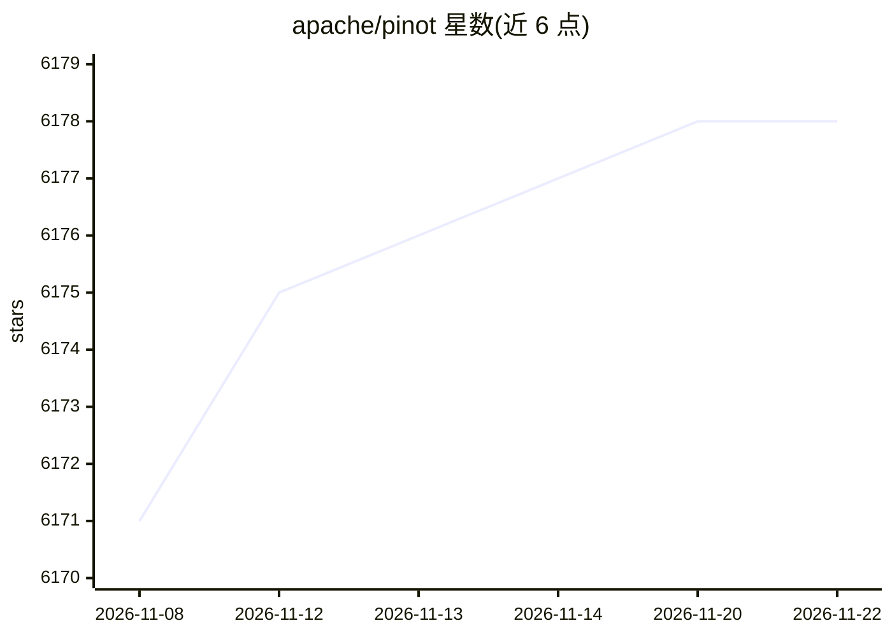

# apache/pinot

⭐ 6,178 · Java · Apache-2.0 · 推送 2026-11-21 · [GitHub](https://github.com/apache/pinot) · [官网](https://pinot.apache.org/) · 组织维护

**实时分布式 OLAP 数据库，支持低延迟 SQL 与向量检索**

Apache Pinot 是 LinkedIn 与 Uber 工程师构建的实时分布式 OLAP 数据存储，面向用户端与 agent 端分析场景。支持从批处理源（HDFS、S3、ADLS、GCS）与流式源（Kafka、Pulsar、Kinesis）摄入数据，提供 SQL 查询接口、实时摄入时的 Upsert、可插拔索引（含 StarTree、HNSW 向量索引）与向量相似度检索，可服务语义搜索、推荐与 RAG。部署方式包括 Docker quickstart 与 Kubernetes Helm chart，LinkedIn 场景中支撑每秒百万级事件摄入与十万级查询。

## 筛选速览

| 维度 | 判定 | 备注 |
|---|---|---|
| AI 角色 | `ai-ecosystem` | LLM/agent 周边工具 |
| 许可风险 | `permissive` | Apache-2.0 |
| 部署形态 | `self-host` | docker 或自建部署 |
| 模型依赖 | — | README 未给出锁定关系 |
| 硬件要求 | — | 无带数字的原话,不猜 |
| 安装摩擦 | `low` | 无编译、无系统依赖或容器化 |
| 成熟度 | — | 结构信号不足 |

## 能力要点

- 支持向量相似度检索，覆盖语义搜索/推荐/RAG 场景
- 流批一体摄入：Kafka/Pulsar/Kinesis 实时，Hadoop/Spark/S3 批量
- 可插拔索引：StarTree、倒排、Bloom、文本、JSON、地理空间等
- 内置多租户与 Kubernetes Helm 集群部署

## 适用场景

- 为用户端产品提供毫秒级实时分析查询
- 作为向量数据库支撑语义搜索与 RAG 检索
- 在高并发场景下对流式事件数据做聚合分析
- 在 Kubernetes 上部署可水平扩展的分析集群

## 场景标签

`向量数据库` `语义搜索` · 领域:知识与检索

## 证据(README 行号)

> L18: Apache Pinot is a real-time distributed OLAP datastore, built to deliver scalable real-time analytics with low late
> L20: Pinot also supports vector similarity search for vector database use cases such as semantic search, recommendations

## 星数曲线

2026-11-08 6,171 → 2026-11-22 6,178（+7）

---
*卡片 v1 · prompt 1.4 · 生成 2026-11-17 · 置信度 high · 依据 README sha `70d2218719a4` · [字段定义](../../DATASET.md)*
