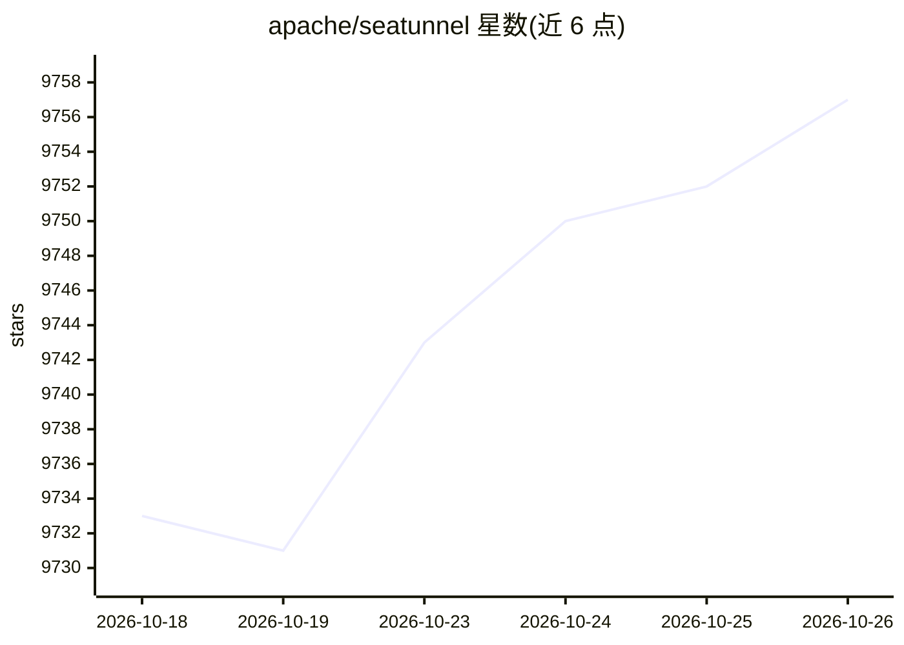

# apache/seatunnel

⭐ 9,757 · Java · Apache-2.0 · 推送 2026-10-25 · [GitHub](https://github.com/apache/seatunnel) · [官网](https://seatunnel.apache.org/) · 组织维护

**分布式多模态数据集成工具：同步海量异构数据**

Apache 基金会下的分布式数据集成工具，提供 160 余个 Source/Sink/Transform 连接器，支持视频、图像、二进制文件与结构化/非结构化文本的多模态数据同步，覆盖实时、CDC、全库等同步场景，内置分布式快照算法保证数据一致性。可运行于自研 Zeta 引擎、Spark 或 Flink 三种执行引擎。面向需要批量与流式数据同步的企业数据工程团队，从官网下载安装包部署，亦支持从源码编译。许可证为 Apache 2.0。

## 筛选速览

| 维度 | 判定 | 备注 |
|---|---|---|
| AI 角色 | `ai-enhanced` | 去掉 AI 部分产品仍成立 |
| 许可风险 | `permissive` | Apache-2.0 |
| 部署形态 | `None` |  |
| 模型依赖 | — | README 未给出锁定关系 |
| 硬件要求 | — | 无带数字的原话,不猜 |
| 安装摩擦 | `low` | 无编译、无系统依赖或容器化 |
| 成熟度 | — | 结构信号不足 |

## 能力要点

- 160 余个连接器，支持批量与流式一体化同步
- 多模态数据集成：视频、图像、二进制文件与文本
- 支持 Zeta、Spark、Flink 三种执行引擎
- 分布式快照算法与实时监控保障数据一致性

## 适用场景

- 在数据库、数据仓库与消息系统之间做批量或实时数据同步
- 通过 CDC 捕获数据库变更并同步到下游
- 同步视频、图像等非结构化数据用于后续处理

## 场景标签

 · 领域:数据集成/ETL

## 证据(README 行号)

> L16: - **Multimodal Data Integration**: Supports the integration of video, images, binary files, structured and unstruct
> L25: - **Multi-Engine Support**: Works with SeaTunnel Zeta Engine, Flink, and Spark.

## 星数曲线

2026-10-18 9,733 → 2026-10-26 9,757（+24）

---
*卡片 v1 · prompt 1.4 · 生成 2026-10-20 · 置信度 low · 依据 README sha `f6e52e1fd15c` · [字段定义](../../DATASET.md)*
