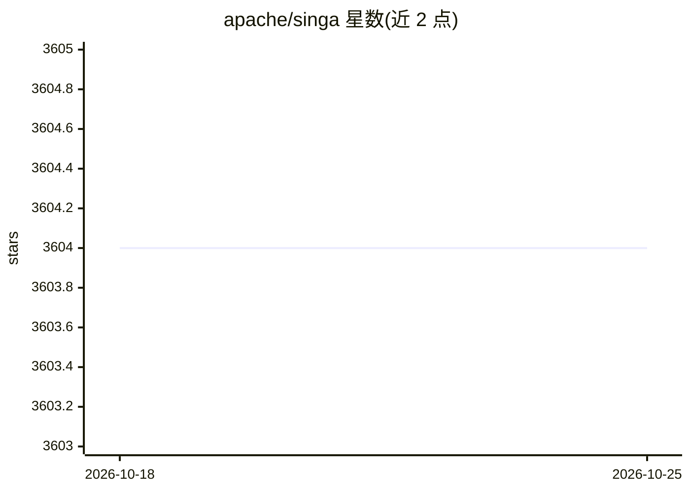

# apache/singa

⭐ 3,604 · C++ · Apache-2.0 · 推送 2026-09-02 · [GitHub](https://github.com/apache/singa) · 组织维护

**Apache 基金会的分布式深度学习系统**

Apache SINGA 是 Apache 软件基金会旗下的分布式深度学习系统，项目描述为 a distributed deep learning platform，提供官网文档、安装指南与示例入口。README 提及 Native Ubuntu/Mac 构建、conda 构建状态与 Docker 镜像拉取状态，并通过 JIRA 跟踪问题、邮件列表进行开发讨论。README 本身信息较简略，具体架构与功能需查阅其官方文档。

## 筛选速览

| 维度 | 判定 | 备注 |
|---|---|---|
| AI 角色 | `ai-native` | 本体是模型或模型工具 |
| 许可风险 | `permissive` | Apache-2.0 |
| 部署形态 | `self-host` | docker 或自建部署 |
| 模型依赖 | — | README 未给出锁定关系 |
| 硬件要求 | — | 无带数字的原话,不猜 |
| 安装摩擦 | `low` | 无编译、无系统依赖或容器化 |
| 成熟度 | — | 结构信号不足 |

## 能力要点

- Apache 基金会顶级项目，分布式深度学习系统
- 支持 Ubuntu/Mac 原生构建与 conda 构建
- 提供 Docker 镜像与官方文档

## 适用场景

- 需要分布式训练的深度学习开发
- 通过 Docker 或 conda 部署深度学习环境

## 场景标签

`模型训练` · 领域:训练与推理

## 证据(README 行号)

> L13: Distributed deep learning system
> L5: Native Ubuntu build status
> L7: conda build status

## 星数曲线

2026-10-18 3,604 → 2026-10-25 3,604（+0）

---
*卡片 v1 · prompt 1.4 · 生成 2026-10-20 · 置信度 low · 依据 README sha `075ca69a1379` · [字段定义](../../DATASET.md)*
