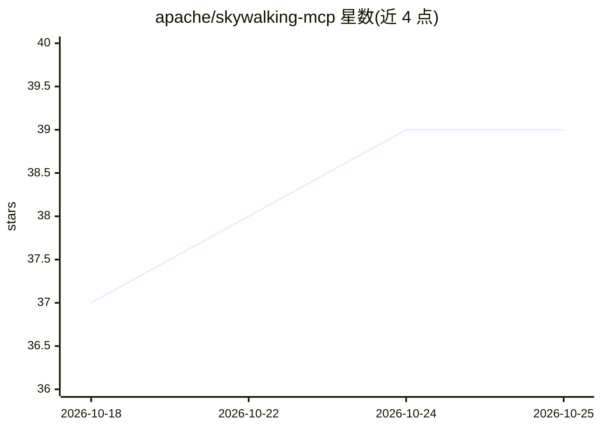

# apache/skywalking-mcp

⭐ 39 · Go · Apache-2.0 · 推送 2026-10-18 · [GitHub](https://github.com/apache/skywalking-mcp) · [官网](https://skywalking.apache.org/) · 组织维护

**让 AI agent 查询 SkyWalking APM 数据的 MCP 服务器**

Apache SkyWalking 官方的 Model Context Protocol (MCP) 服务器，用 Go 编写，把 AI agent（Cursor、Copilot、Claude Code 等）接入 SkyWalking OAP 可观测性数据。提供 17 个查询工具（Trace、Log、MQE 指标、元数据、事件、告警、拓扑）与 10 个引导分析 Prompt（性能对比、Trace 深挖、拓扑探索等）。支持 stdio/sse/streamable 三种传输，内置 DNS rebinding 防护与来源白名单选项；可通过源码构建或 Docker 镜像运行。

## 筛选速览

| 维度 | 判定 | 备注 |
|---|---|---|
| AI 角色 | `ai-ecosystem` | LLM/agent 周边工具 |
| 许可风险 | `permissive` | Apache-2.0 |
| 部署形态 | `self-host` | docker 或自建部署 |
| 模型依赖 | — | README 未给出锁定关系 |
| 硬件要求 | — | 无带数字的原话,不猜 |
| 安装摩擦 | `low` | 无编译、无系统依赖或容器化 |
| 成熟度 | — | 结构信号不足 |

## 能力要点

- 17 个工具覆盖 Trace/日志/MQE 指标/元数据/事件/告警/拓扑查询
- 10 个引导式分析 Prompt（性能对比、Trace 深挖、MQE 构建等）
- 支持 stdio、sse、streamable 三种 MCP 传输方式
- 提供 Docker 镜像构建（linux/amd64 与 arm64 多平台）

## 适用场景

- 在 Cursor/Copilot/Claude Code 中用自然语言排查服务性能问题
- 让 AI agent 查询链路、日志与告警做根因分析
- 通过 MQE 表达式查询与计算监控指标

## 场景标签

 · 领域:可观测性/APM 工具

## 证据(README 行号)

> L5: **SkyWalking-MCP**: A [Model Context Protocol][mcp] (MCP) server for integrating AI agents with Skywalking OAP and t
> L104: SkyWalking MCP provides the following tools to query and analyze SkyWalking OAP data:

## 星数曲线

2026-10-18 37 → 2026-10-25 39（+2）

---
*卡片 v1 · prompt 1.4 · 生成 2026-10-25 · 置信度 high · 依据 README sha `ae78b0e8aa3f` · [字段定义](../../DATASET.md)*
