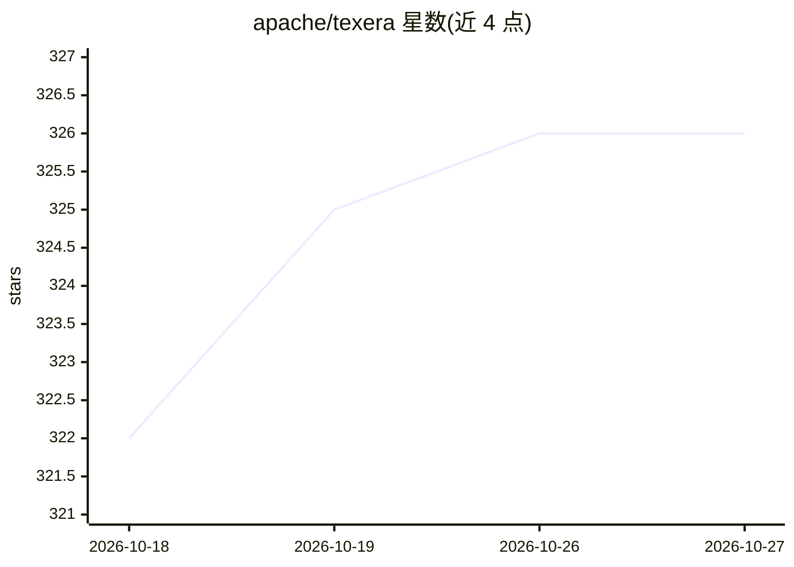

# apache/texera

⭐ 326 · Scala · Apache-2.0 · 推送 2026-10-26 · [GitHub](https://github.com/apache/texera) · [官网](https://texera.apache.org/) · 组织维护

**面向数据分析师的可视化工作流人机协同数据科学平台**

Apache 孵化中的开源平台，供人类分析师通过 GUI 构建、执行与迭代数据分析工作流，并由理解自然语言指令的 AI agent 协助完成数据科学任务。工作流运行时语言无关，原生支持 Python 与 Java，后端并行引擎可扩展处理大数据，计算与存储分离以支持云部署；也可在笔记本本地运行。适用于包括“AI for Science”在内的多种应用场景。项目附有 VLDB 论文可供引用。

## 筛选速览

| 维度 | 判定 | 备注 |
|---|---|---|
| AI 角色 | `ai-ecosystem` | LLM/agent 周边工具 |
| 许可风险 | `permissive` | Apache-2.0 |
| 部署形态 | `None` |  |
| 模型依赖 | — | README 未给出锁定关系 |
| 硬件要求 | — | 无带数字的原话,不猜 |
| 安装摩擦 | `low` | 无编译、无系统依赖或容器化 |
| 成熟度 | — | 结构信号不足 |

## 能力要点

- 自然语言数据科学：AI agent 理解自然语言指令
- GUI 可视化工作流构建与实时协同编辑/执行
- 运行时调试与交互式工作流执行
- 语言无关运行时，原生支持 Python 与 Java，并行后端引擎

## 适用场景

- 通过可视化界面构建并执行数据分析工作流
- 用自然语言让 AI agent 协助完成数据科学任务
- 从本地笔记本到云端部署处理大规模数据集

## 场景标签

`数据分析` `工作流自动化` · 领域:效率与自动化

## 证据(README 行号)

> L24: Apache Texera (Incubating) is an open-source platform for human-AI collaborative data science using visual workflow
> L28: * Natural-language data science through AI agents
> L32: * Language-agnostic workflow runtime, native support for Python and Java

## 星数曲线

2026-10-18 322 → 2026-10-27 326（+4）

---
*卡片 v1 · prompt 1.4 · 生成 2026-10-21 · 置信度 mid · 依据 README sha `c373ad9af347` · [字段定义](../../DATASET.md)*
