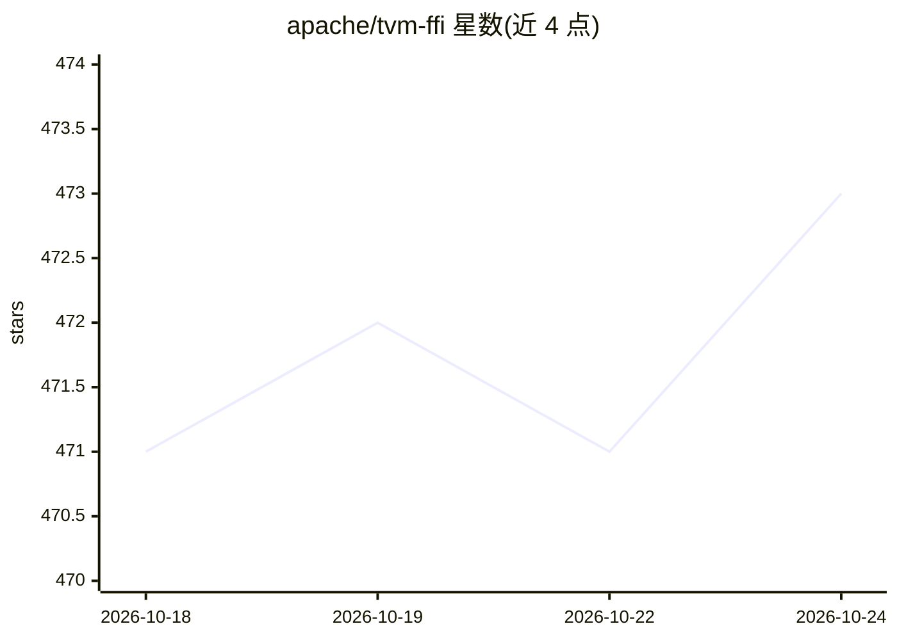

# apache/tvm-ffi

⭐ 473 · C++ · Apache-2.0 · 推送 2026-10-23 · [GitHub](https://github.com/apache/tvm-ffi) · [官网](https://tvm.apache.org/ffi) · 组织维护

**机器学习系统的开放 ABI 与 FFI：跨框架零拷贝互操作**

Apache TVM FFI 提供稳定、最小化的 C ABI 与外部函数接口，面向内核库、内核 DSL、框架与运行时及 ML 基础设施：通过 DLPack 协议在 PyTorch、JAX、CuPy 间实现零拷贝互操作，一个 wheel 可支持多框架、多 Python 版本（含 free-threaded Python），内置 Python/C++/Rust 绑定。当前处于 RFC 阶段，C ABI 已稳定但版本 0.X.Y 中 X 变更表示 ABI 破坏性改动，计划三个月后转入语义化版本。

## 筛选速览

| 维度 | 判定 | 备注 |
|---|---|---|
| AI 角色 | `ai-ecosystem` | LLM/agent 周边工具 |
| 许可风险 | `permissive` | Apache-2.0 |
| 部署形态 | `library` | 以包/库形式分发 |
| 模型依赖 | — | README 未给出锁定关系 |
| 硬件要求 | — | 无带数字的原话,不猜 |
| 安装摩擦 | `low` | 无编译、无系统依赖或容器化 |
| 成熟度 | `idea` | |

## 能力要点

- 稳定、最小化 C ABI，面向内核、DSL 与运行时扩展
- 基于 DLPack 的 PyTorch/JAX/CuPy 零拷贝互操作
- 一个 wheel 支持多框架与多 Python 版本（含 free-threaded）
- Python/C++/Rust 多语言绑定

## 适用场景

- 内核库发布单一 wheel 覆盖多框架与多语言
- 内核 DSL 框架复用统一开放 ABI 暴露 JIT/AOT 内核
- 跨语言 ML 基础设施中做绑定与互操作

## 场景标签

 · 领域:机器学习基础设施

## 证据(README 行号)

> L5: Apache TVM FFI is an open ABI and FFI for machine learning systems. It is a minimal, framework-agnostic,
> L16: - **Stable, minimal C ABI** designed for kernels, DSLs, and runtime extensibility.

## 星数曲线

2026-10-18 471 → 2026-10-24 473（+2）

---
*卡片 v1 · prompt 1.4 · 生成 2026-10-21 · 置信度 high · 依据 README sha `09a08c611f48` · [字段定义](../../DATASET.md)*
