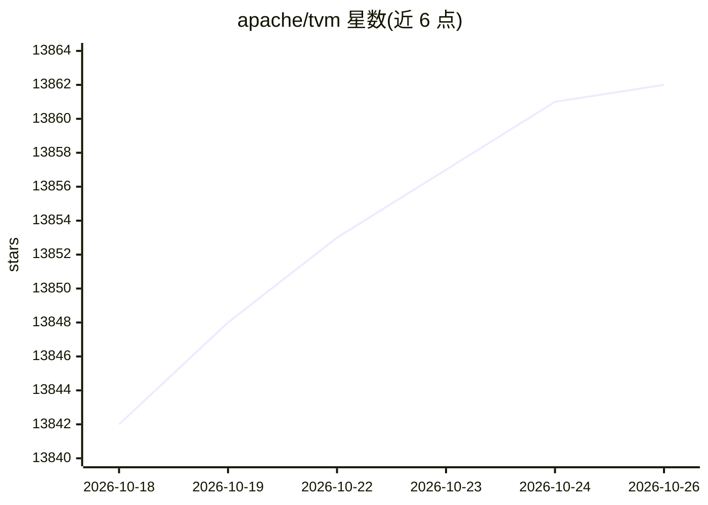

# apache/tvm

⭐ 13,862 · Python · Apache-2.0 · 推送 2026-10-24 · [GitHub](https://github.com/apache/tvm) · [官网](https://tvm.apache.org/) · 组织维护

**面向 ML 开发者的开源机器学习编译框架**

Apache TVM 是开源机器学习编译框架，采用 Python-first 开发方式，支持对编译流水线的快速自定义，并将模型部署为最小可部署模块。当前设计以 TensorIR 作为张量级表示、Relax 作为图级表示，可联合优化计算图、张量程序与库；定位为构建面向 LLM 等领域的 Python-first 垂直编译器的基础设施。采用 Apache committer 社区治理模式，源自深度学习编译研究项目，受 Halide、Loopy、Theano 影响。安装教程见其文档站点。

## 筛选速览

| 维度 | 判定 | 备注 |
|---|---|---|
| AI 角色 | `ai-ecosystem` | LLM/agent 周边工具 |
| 许可风险 | `permissive` | Apache-2.0 |
| 部署形态 | `None` |  |
| 模型依赖 | — | README 未给出锁定关系 |
| 硬件要求 | — | 无带数字的原话,不猜 |
| 安装摩擦 | `low` | 无编译、无系统依赖或容器化 |
| 成熟度 | — | 结构信号不足 |

## 动量与使用信号

- 维护:`active` — 距上次 push 0.7 天,年发版 12,368 位贡献者
- 涨星:近 1 天 **+3**(自 20261016 起算)
- 下载:GitHub Release 附件 累计 7,397(34 个 release)

## 能力要点

- TensorIR（张量级）与 Relax（图级）跨层表示设计
- Python-first 变换，多数转换可用 Python 自定义
- 通用部署，将模型编译为最小可部署模块
- 定位为构建 LLM 等领域垂直编译器的基础设施

## 适用场景

- 为深度学习模型做编译优化与部署
- 在 Python 中自定义机器学习编译流水线
- 基于 TVM 构建面向特定领域（如 LLM）的编译器

## 场景标签

 · 领域:机器学习编译/基础设施

## 证据(README 行号)

> L7: Apache TVM is an open machine learning compilation framework,
> L39: and Relax as the graph-level representation and Python-first transformations.
> L43: infra for building Python-first vertical compilers for domains, such as LLMs.

## 星数曲线

2026-10-18 13,842 → 2026-10-26 13,862（+20）

---
*卡片 v1 · prompt 1.4 · 生成 2026-10-18 · 置信度 high · 依据 README sha `9dae7c21ebac` · [字段定义](../../DATASET.md)*
