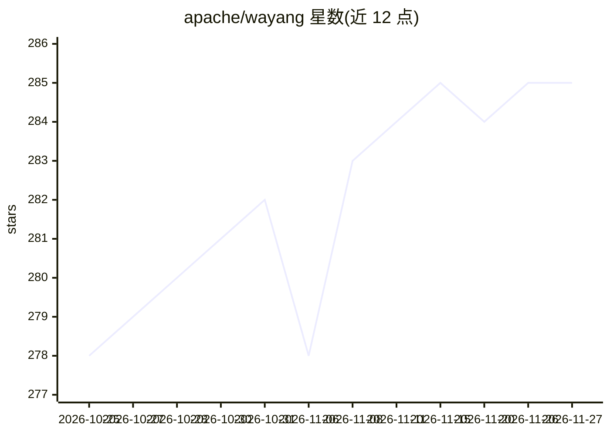

# apache/wayang

⭐ 285 · Java · Apache-2.0 · 推送 2026-11-25 · [GitHub](https://github.com/apache/wayang) · [官网](https://wayang.apache.org/) · 组织维护

**跨平台大数据处理框架：一次编写管道，多引擎运行**

Apache Wayang 是一个基于 Java 的跨平台数据处理系统：用户针对单一 API 编写数据管道，注册本地已有引擎（Java Streams、Spark、Flink、Giraph、Postgres、SQLite、Kafka、TensorFlow）后运行；其基于成本的优化器可为每一步选择执行平台，并支持将单个任务拆分到多个引擎。提供 Maven Central 依赖引入与源码构建两种方式，运行需 Java 17，使用 Spark/Hadoop 时需额外环境变量与 JVM 参数。

## 筛选速览

| 维度 | 判定 | 备注 |
|---|---|---|
| AI 角色 | `ai-enhanced` | 去掉 AI 部分产品仍成立 |
| 许可风险 | `permissive` | Apache-2.0 |
| 部署形态 | `desktop` | 安装包/桌面程序 |
| 模型依赖 | — | README 未给出锁定关系 |
| 硬件要求 | — | 无带数字的原话,不猜 |
| 安装摩擦 | `medium` | 含编译或系统依赖之一 |
| 成熟度 | — | 结构信号不足 |

## 能力要点

- 单一 API 编写管道，可注册 Spark/Flink/Postgres 等多个执行引擎
- 基于成本的优化器为每个算子选择平台，支持单任务跨引擎拆分
- 插件架构支持在不改动内部的情况下新增算子与平台
- 提供 Java/Scala/SQL API，附 wordcount 等示例应用

## 适用场景

- 数据管道需要跨 Spark、Flink 与数据库等多种引擎运行
- 数据规模增长时迁移执行平台而不重写管道代码
- 将同一个作业的多个步骤分配到不同引擎执行

## 场景标签

 · 领域:大数据/分布式数据处理

## 证据(README 行号)

> L16: You write your pipeline against a single API, then decide how it runs. Point it at one engine and it runs there. Or
> L26: Wayang sits one level up. You write a pipeline against Wayang's API and register the engines you *have*. Then it's 
> L37: - TensorFlow

## 星数曲线

2026-10-25 278 → 2026-11-27 285（+7）

---
*卡片 v1 · prompt 1.4 · 生成 2026-11-26 · 置信度 mid · 依据 README sha `9993f845cac4` · [字段定义](../../DATASET.md)*
