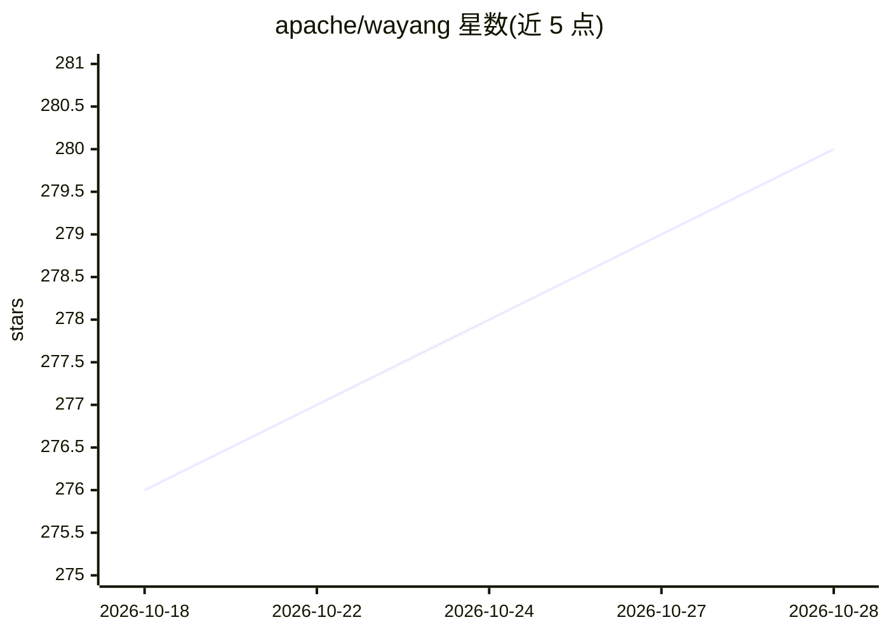

# apache/wayang

⭐ 280 · Java · Apache-2.0 · 推送 2026-10-27 · [GitHub](https://github.com/apache/wayang) · [官网](https://wayang.apache.org/) · 组织维护

**跨平台数据处理系统：一次编写流水线，多引擎择优执行**

Apache 顶级项目（前身为 Rheem）：用户用统一 API 编写数据流水线，注册本地 Java、Spark、Flink、PostgreSQL、SQLite、Kafka、TensorFlow 等执行平台，可指定单一引擎运行，也可交给基于代价的优化器为每一步选引擎，甚至把一个作业拆到多个引擎执行。提供 Java/Scala/SQL API 与插件架构，可扩展新算子和平台；从 Maven Central 依赖引入或源码构建，运行需 Java 17，配合 Spark 需 Hadoop 3+。附多篇 SIGMOD/VLDB 论文。

## 筛选速览

| 维度 | 判定 | 备注 |
|---|---|---|
| AI 角色 | `ai-ecosystem` | LLM/agent 周边工具 |
| 许可风险 | `permissive` | Apache-2.0 |
| 部署形态 | `desktop` | 安装包/桌面程序 |
| 模型依赖 | — | README 未给出锁定关系 |
| 硬件要求 | — | 无带数字的原话,不猜 |
| 安装摩擦 | `medium` | 含编译或系统依赖之一 |
| 成熟度 | — | 结构信号不足 |

## 能力要点

- 单一 API 编写流水线，切换引擎只改注册插件不改代码
- 基于代价的优化器按步择优，可将作业拆分到多引擎执行
- 支持 Java Streams/Spark/Flink/Giraph/PostgreSQL/SQLite/Kafka/TensorFlow 等平台
- 插件架构支持新增算子与平台而不改动内核

## 适用场景

- 本地开发小数据、上线后无缝切换到 Spark/Flink 执行同一流水线
- 数据量增长后不重写代码，让优化器在多引擎间分配作业
- 在统一框架下把数据处理与 TensorFlow 计算组合在同一流水线

## 场景标签

 · 领域:大数据/分布式数据处理

## 证据(README 行号)

> L16: You write your pipeline against a single API, then decide how it runs. Point it at one engine and it runs there. Or
> L18:  A single pipeline, written once, feeds the Wayang optimizer, which routes each step to the best available engine —
> L37: - TensorFlow

## 星数曲线

2026-10-18 276 → 2026-10-28 280（+4）

---
*卡片 v1 · prompt 1.4 · 生成 2026-10-22 · 置信度 high · 依据 README sha `736ecfa7279c` · [字段定义](../../DATASET.md)*
