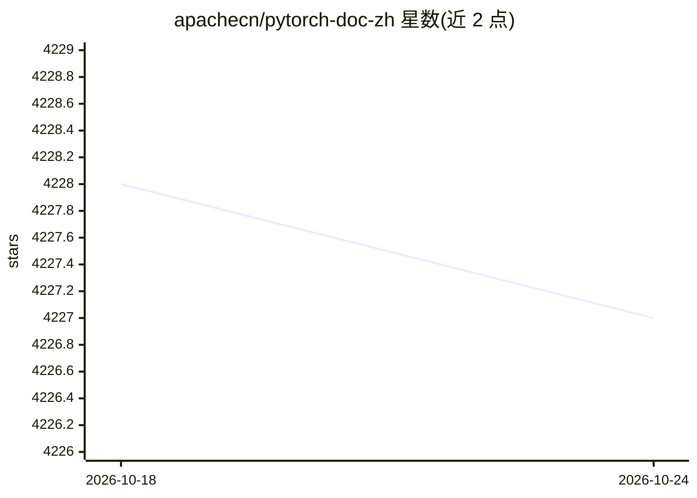

# apachecn/pytorch-doc-zh

⭐ 4,227 · Shell · 推送 2026-01-07 · [GitHub](https://github.com/apachecn/pytorch-doc-zh) · [官网](https://pytorch.apachecn.org) · 组织维护 · 中文 README

**PyTorch 官方文档与教程的中文翻译项目**

由 ApacheCN 维护的 PyTorch 中文文档翻译仓库，正在翻译 2.0 版本，提供 GitHub Pages 在线阅读站点，并列出第三方镜像站点与 PyTorch 官方入口。面向需要中文资料的深度学习框架使用者，通过 GitHub Pages 组织构建网站，欢迎社区参与翻译完善，通过 GitHub issue、邮箱与 QQ 群接收反馈。

## 筛选速览

| 维度 | 判定 | 备注 |
|---|---|---|
| AI 角色 | `ai-knowledge` | 知识聚合/清单类 |
| 许可风险 | `none` | — |
| 部署形态 | `None` |  |
| 模型依赖 | — | README 未给出锁定关系 |
| 硬件要求 | — | 无带数字的原话,不猜 |
| 安装摩擦 | `low` | 无编译、无系统依赖或容器化 |
| 成熟度 | — | 结构信号不足 |

## 能力要点

- PyTorch 官方文档与教程的中文翻译（进行中：2.0 版本）
- 提供 GitHub Pages 在线阅读站点
- 社区共建翻译，通过 issue/邮箱/QQ 群接收反馈

## 适用场景

- 用中文查阅 PyTorch 官方文档与教程
- 参与 PyTorch 文档的中文翻译与校对

## 场景标签

`教程课程` · 领域:学习与行业

## 证据(README 行号)

> L1: # PyTorch 中文文档 & 教程
> L5:  正在翻译: 2.0 中文版本
> L17: + GitHub Pages: <https://pytorch.apachecn.org>

## 星数曲线

2026-10-18 4,228 → 2026-10-24 4,227（-1）

---
*卡片 v1 · prompt 1.4 · 生成 2026-10-20 · 置信度 high · 依据 README sha `2bb3acdb463f` · [字段定义](../../DATASET.md)*
