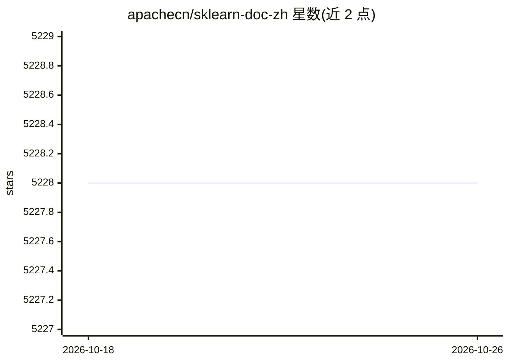

# apachecn/sklearn-doc-zh

⭐ 5,228 · CSS · NOASSERTION · 推送 2026-08-27 · [GitHub](https://github.com/apachecn/sklearn-doc-zh) · [官网](http://sklearn.apachecn.org) · 组织维护 · 中文 README

**scikit-learn 0.21.3 官方文档中文翻译**

ApacheCN 组织维护的 scikit-learn 中文文档翻译项目，当前覆盖 0.21.3 版本文档与示例，并提供 0.19、0.18 历史版本的编译说明（gitbook 编译、图片资源复制）。文档通过 GitHub Pages 提供在线访问，另支持 Docker、pip、npm 三种方式本地起服务阅读，以及 EPUB 下载。内容许可为 CC BY-NC-SA 4.0，禁止商业化。项目列出两期负责人与贡献者招募要求。

## 筛选速览

| 维度 | 判定 | 备注 |
|---|---|---|
| AI 角色 | `ai-knowledge` | 知识聚合/清单类 |
| 许可风险 | `none` | NOASSERTION |
| 部署形态 | `self-host` | docker 或自建部署 |
| 模型依赖 | — | README 未给出锁定关系 |
| 硬件要求 | — | 无带数字的原话,不猜 |
| 安装摩擦 | `low` | 无编译、无系统依赖或容器化 |
| 成熟度 | — | 结构信号不足 |

## 能力要点

- sklearn 0.21.3 文档与示例的中文翻译，附 0.19/0.18 历史版本
- Docker/pip/npm 三种本地阅读方式，另有 EPUB 下载
- 由 ApacheCN 组织翻译，多期负责人与贡献者协作

## 适用场景

- 中文阅读 scikit-learn 官方文档与示例
- 离线或本地部署 sklearn 中文文档供团队查阅
- 下载 EPUB 版本在移动设备上阅读

## 场景标签

`教程课程` · 领域:学习与行业

## 证据(README 行号)

> L1: # scikit-learn (sklearn) 官方文档中文版
> L11: sklearn (scikit-learn) 是基于 Python 语言的机器学习工具
> L119: * ApacheCN 账号下没有协议的项目，一律视为 CC BY-NC-SA 4.0。

## 星数曲线

2026-10-18 5,228 → 2026-10-26 5,228（+0）

---
*卡片 v1 · prompt 1.4 · 生成 2026-10-20 · 置信度 high · 依据 README sha `a26215b0473a` · [字段定义](../../DATASET.md)*
