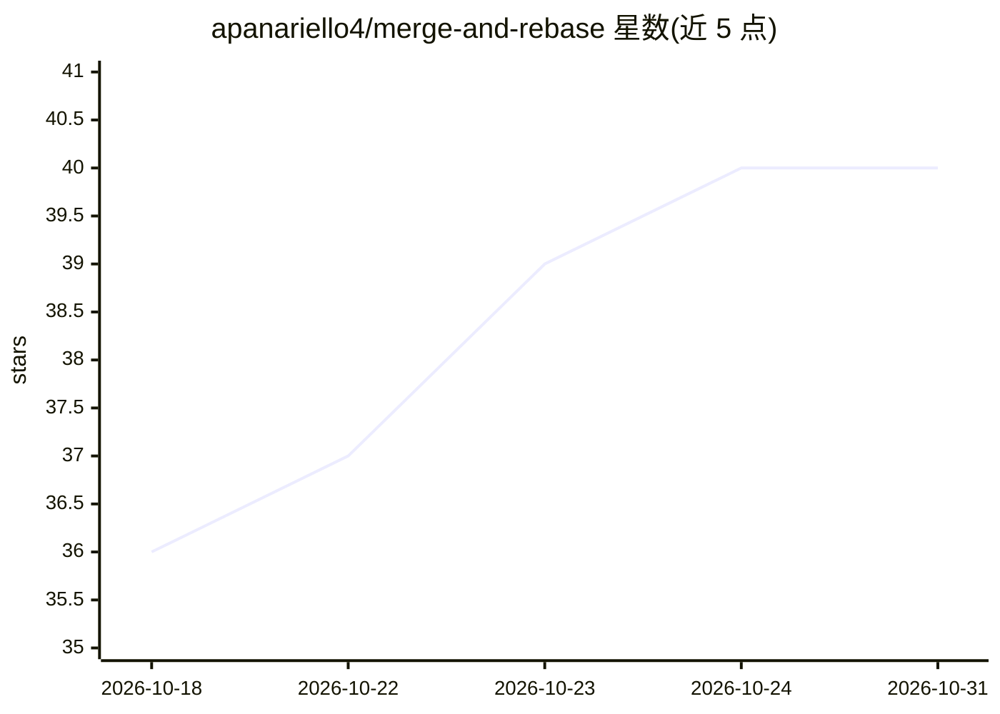

# apanariello4/merge-and-rebase

⭐ 40 · Python · Apache-2.0 · 推送 2026-10-23 · [GitHub](https://github.com/apanariello4/merge-and-rebase) · 个人维护

**模型合并、任务向量迁移与微调的研究代码库，面向视觉与 LLM 模型**

面向研究者的 Python 代码库，覆盖视觉与文本模型的微调、模型合并、任务向量迁移（rebasin）与评测；托管 GradFix、TAK、DELTA、Theseus 四篇论文的官方实现，支持 Ariadne 等方法将任务向量迁移到不同宽度/深度的基座模型（如 Qwen2.5 0.5B→1.5B）。通过 uv 以可编辑模式安装，提供配置驱动的命令行入口与文档站点；checkpoint 经 hf-hub 引用自动下载。

## 筛选速览

| 维度 | 判定 | 备注 |
|---|---|---|
| AI 角色 | `ai-ecosystem` | LLM/agent 周边工具 |
| 许可风险 | `permissive` | Apache-2.0 |
| 部署形态 | `library` | 以包/库形式分发 |
| 模型依赖 | — | README 未给出锁定关系 |
| 硬件要求 | — | 无带数字的原话,不猜 |
| 安装摩擦 | `low` | 无编译、无系统依赖或容器化 |
| 成熟度 | — | 结构信号不足 |

## 能力要点

- 微调、合并、任务向量迁移与评测的统一代码库
- GradFix/TAK/DELTA/Theseus 四篇论文的官方实现
- 支持跨架构（宽度/深度变化）迁移任务向量，含视觉与 Qwen 解码器入口
- 提供文档站点、教程与配置参考

## 适用场景

- 复现论文中的任务向量迁移与合并实验
- 研究不同基座模型间的微调权重迁移
- 评测合并方法的性能表现

## 场景标签

`微调` · 领域:训练与推理

## 证据(README 行号)

> L9: `merge-and-rebase` is a research codebase for fine-tuning, model merging, task-vector transport, and evaluation acro
> L30: Transport a task vector to a different (wider/deeper) base with Ariadne, on vision or on Qwen decoders:

## 星数曲线

2026-10-18 36 → 2026-10-31 40（+4）

---
*卡片 v1 · prompt 1.4 · 生成 2026-10-25 · 置信度 high · 依据 README sha `707c11b896e4` · [字段定义](../../DATASET.md)*
