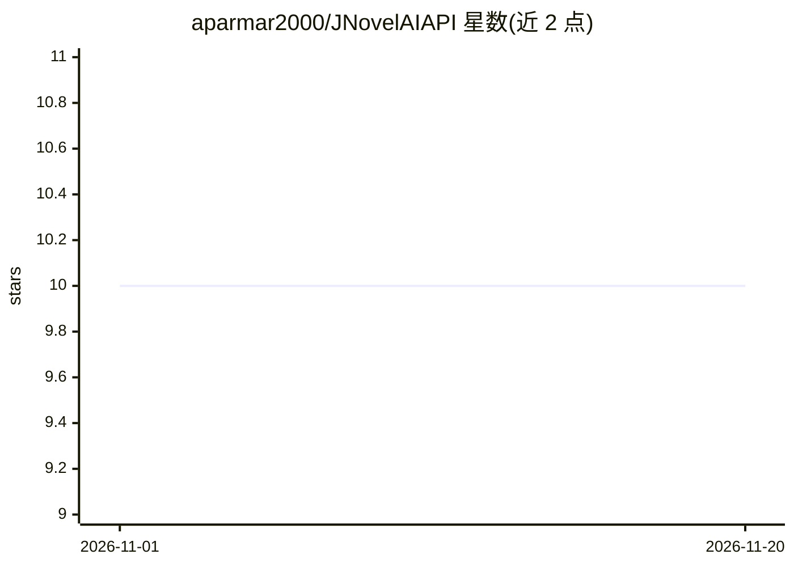

# aparmar2000/JNovelAIAPI

⭐ 10 · Java · LGPL-2.1 · 推送 2026-11-16 · [GitHub](https://github.com/aparmar2000/JNovelAIAPI) · 个人维护

**Java 开发者调用 NovelAI 生成 API 的绑定库**

面向 Java 8 的开源库，封装 NovelAI 官方 REST API 的调用：自动处理限速（每秒一次请求）、响应解析与 tokenization。通过 Jitpack 以 Maven/Gradle 依赖分发，创建 NAIAPI 实例并传入 API key 后即可调用各端点方法，包括图像生成、图像修补与文本生成（如 Kayra 模型、参数预设）。示例代码见集成测试。

## 筛选速览

| 维度 | 判定 | 备注 |
|---|---|---|
| AI 角色 | `ai-ecosystem` | LLM/agent 周边工具 |
| 许可风险 | `viral` | LGPL-2.1 |
| 部署形态 | `None` |  |
| 模型依赖 | — | README 未给出锁定关系 |
| 硬件要求 | — | 无带数字的原话,不猜 |
| 安装摩擦 | `medium` | 含编译或系统依赖之一 |
| 成熟度 | — | 结构信号不足 |

## 能力要点

- 封装 NovelAI REST API，自动处理限速、响应解析与 tokenization
- 支持图像生成与 inpainting 请求构建
- 支持文本生成，含模型选择与参数预设（如 Plotfish/Kayra）
- 经 Jitpack 分发，Maven/Gradle 一行依赖引入

## 适用场景

- 在 Java 项目中程序化调用 NovelAI 生成图像
- 用 Java 代码批量调用 NovelAI 做文本生成
- 需要自带限速与响应解析的 NovelAI API 封装

## 场景标签

`图像生成` · 领域:内容生成

## 证据(README 行号)

> L8: This is a decently-functional Java library that facilitates usage of the NovelAI official API. It handles _most_ thi
> L51: Then call any of the endpoint methods - for example, to generate an image:

## 星数曲线

2026-11-01 10 → 2026-11-20 10（+0）

---
*卡片 v1 · prompt 1.4 · 生成 2026-11-20 · 置信度 high · 依据 README sha `6dd81948dd90` · [字段定义](../../DATASET.md)*
