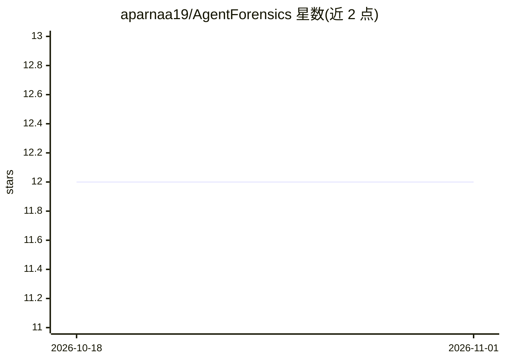

# aparnaa19/AgentForensics

⭐ 12 · Python · MIT · 推送 2026-05-09 · [GitHub](https://github.com/aparnaa19/AgentForensics) · 个人维护

**LLM agent 会话的实时提示注入检测与取证框架**

监控完整 LLM agent 会话的开源安全框架：以五级检测流水线（启发式规则、DistilBERT 分类器、指令边界分析、语义漂移、滑动窗口多轮检测）识别工具输出、网页、文档与 API 响应中的间接提示注入，并对攻击模式做指纹聚类形成 campaign。接入方式包括 Claude Desktop MCP、OpenAI/Anthropic SDK 代码包装器、LangChain/AutoGen 集成、VS Code 扩展与实时取证仪表盘。在 ARPIbench 基准上报告检出率 100%、误报率 0%（README 自述数据）。Python 3.10+，Node.js 18+ 用于扩展构建。

## 筛选速览

| 维度 | 判定 | 备注 |
|---|---|---|
| AI 角色 | `ai-ecosystem` | LLM/agent 周边工具 |
| 许可风险 | `permissive` | MIT |
| 部署形态 | `library` | 以包/库形式分发 |
| 模型依赖 | locked-api |  |
| 硬件要求 | — | 无带数字的原话,不猜 |
| 安装摩擦 | `low` | 无编译、无系统依赖或容器化 |
| 成熟度 | — | 结构信号不足 |

## 能力要点

- 五级检测流水线（启发式/ML/指令边界/语义漂移/多轮检测）
- 攻击指纹聚类与跨会话 campaign 追踪
- 零代码改动接入：MCP、SDK 包装器、LangChain/AutoGen 集成、VS Code 扩展
- 实时取证仪表盘与误报永久抑制机制

## 适用场景

- 为调用外部内容的 LLM agent 检测间接提示注入攻击
- 对 agent 会话做取证分析并追踪重复攻击活动
- 在 VS Code 中扫描文件内容里的注入指令

## 场景标签

`网络安全` · 领域:学习与行业

## 证据(README 行号)

> L12: AgentForensics is an open-source security framework that monitors LLM agent sessions in real time, detects prompt i
> L20: Existing tools focus on input filtering at the user layer. AgentForensics monitors the **entire agent session** inc
> L39: - **Five-stage detection pipeline** - heuristics, ML classifier, instruction boundary analysis, semantic drift, and

## 星数曲线

2026-10-18 12 → 2026-11-01 12（+0）

---
*卡片 v1 · prompt 1.4 · 生成 2026-11-01 · 置信度 high · 依据 README sha `4467f88165a0` · [字段定义](../../DATASET.md)*
