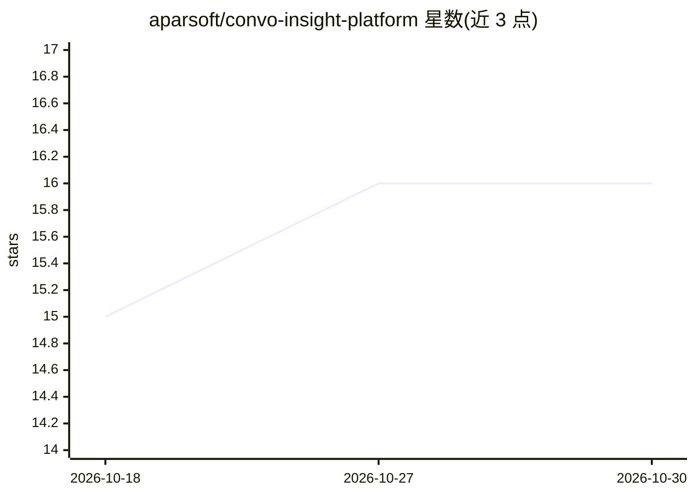

# aparsoft/convo-insight-platform

⭐ 16 · Python · Apache-2.0 · 推送 2026-05-31 · [GitHub](https://github.com/aparsoft/convo-insight-platform) · 个人维护

**面向企业的客户对话智能平台：LLM 分析对话并支持客服代理**

Django + Next.js 全栈平台，分析来自聊天、语音、邮件渠道的客户对话：用三种 NLP 方法（微调 BERT、GPT-4o-mini 少样本、PGVector RAG）做情感/意图/主题/NER 分析，内置 LangGraph 客服代理，支持订单追踪、修改、取消等工具调用与 WebSocket 流式响应，并提供仪表盘与电商订单管理。需 OpenAI、HuggingFace、Tavily 的 API key，README 声明仅为学习演示项目，未设计或测试用于生产环境。

## 筛选速览

| 维度 | 判定 | 备注 |
|---|---|---|
| AI 角色 | `ai-native` | 本体是模型或模型工具 |
| 许可风险 | `permissive` | Apache-2.0 |
| 部署形态 | `self-host` | docker 或自建部署 |
| 模型依赖 | — | README 未给出锁定关系 |
| 硬件要求 | — | 无带数字的原话,不猜 |
| 安装摩擦 | `low` | 无编译、无系统依赖或容器化 |
| 成熟度 | `idea` | |

## 能力要点

- 三路 NLP 分析：微调 BERT、少样本 GPT、PGVector RAG
- LangGraph 客服代理带工具调用与 WebSocket 流式输出
- 21 个 ViewSet 的 REST API、JWT 认证与 OpenAPI 文档
- Docker Compose 启动全栈（Postgres+pgvector、Redis、Daphne、Celery）

## 适用场景

- 电商客服场景中分析客户对话的情绪与意图
- 用 LLM 代理处理订单追踪、修改与取消的客服请求
- 在仪表盘中查看对话指标与代理表现评估

## 场景标签

`聊天机器人` `RAG` `数据分析` · 领域:效率与自动化

## 证据(README 行号)

> L3: ConvoInsight is a Customer Conversational Intelligence Platform powered by Large Language Models (LLMs) and advanced
> L26: The platform includes a **LangGraph-based support agent** that handles e-commerce customer support conversations wi

## 星数曲线

2026-10-18 15 → 2026-10-30 16（+1）

---
*卡片 v1 · prompt 1.4 · 生成 2026-10-30 · 置信度 mid · 依据 README sha `91c49eaf9120` · [字段定义](../../DATASET.md)*
