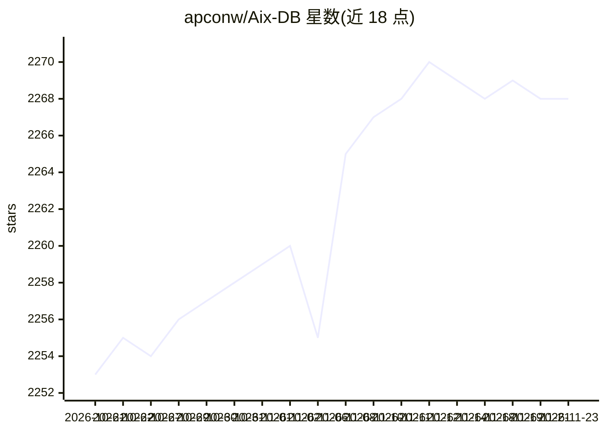

# apconw/Aix-DB

⭐ 2,268 · JavaScript · 推送 2026-11-06 · [GitHub](https://github.com/apconw/Aix-DB) · [官网](https://db.aixhub.top/) · 个人维护 · 中文 README

**对话式数据分析（ChatBI）系统，自然语言转 SQL 与可视化**

基于 LangChain/LangGraph 与 MCP Skills 多智能体架构的智能数据分析系统：用户以自然语言提问，经 LLM 意图理解、Embedding+BM25 混合检索（结合 Neo4j 图谱）获取表结构知识，Text2SQL 引擎生成并校验 SQL，在目标数据源执行后自动生成 ECharts/AntV 图表。提供 Web 界面与 CLI，支持 8+ 种数据库；Docker 部署需配置 JWT_SECRET_KEY，本地开发需 Python 3.11。另提供面向企业场景的 Aix-DB Pro 商业版（看板、报告中心）。

## 筛选速览

| 维度 | 判定 | 备注 |
|---|---|---|
| AI 角色 | `ai-native` | 本体是模型或模型工具 |
| 许可风险 | `none` | — |
| 部署形态 | `self-host` | docker 或自建部署 |
| 模型依赖 | — | README 未给出锁定关系 |
| 硬件要求 | — | 无带数字的原话,不猜 |
| 安装摩擦 | `low` | 无编译、无系统依赖或容器化 |
| 成熟度 | — | 结构信号不足 |

## 能力要点

- Text2SQL 流程：意图理解→RAG 混合检索→SQL 生成校验→执行→可视化
- Embedding + BM25 混合检索并结合 Neo4j 图谱获取表结构与业务知识
- 支持 MCP 多智能体协作与 Skill 模式
- 提供 Web 界面（Vue 3 + Sanic）与全局 CLI 工具两种使用入口

## 适用场景

- 业务人员用自然语言查询数据库并直接获得图表
- 为多种关系型/分析型数据库搭建 ChatBI 问答入口
- 沉淀分析报告与数据看板供团队复用（Pro 版）

## 场景标签

`数据分析` `RAG` · 领域:效率与自动化

## 证据(README 行号)

> L7:  基于大语言模型和RAG技术的智能数据分析系统，实现对话式数据分析（ChatBI），快速实现数据提取与可视化
> L18: Aix-DB 基于 **LangChain/LangGraph** 框架，结合 **MCP Skills** 多智能体协作架构，实现自然语言到数据洞察的端到端转换。
> L179: |2|**LLM 意图理解**|大模型解析问题意图，抽取关键实体和查询条件|

## 星数曲线

2026-10-21 2,253 → 2026-11-23 2,268（+15）

---
*卡片 v1 · prompt 1.4 · 生成 2026-11-23 · 置信度 high · 依据 README sha `366619ab2a4b` · [字段定义](../../DATASET.md)*
