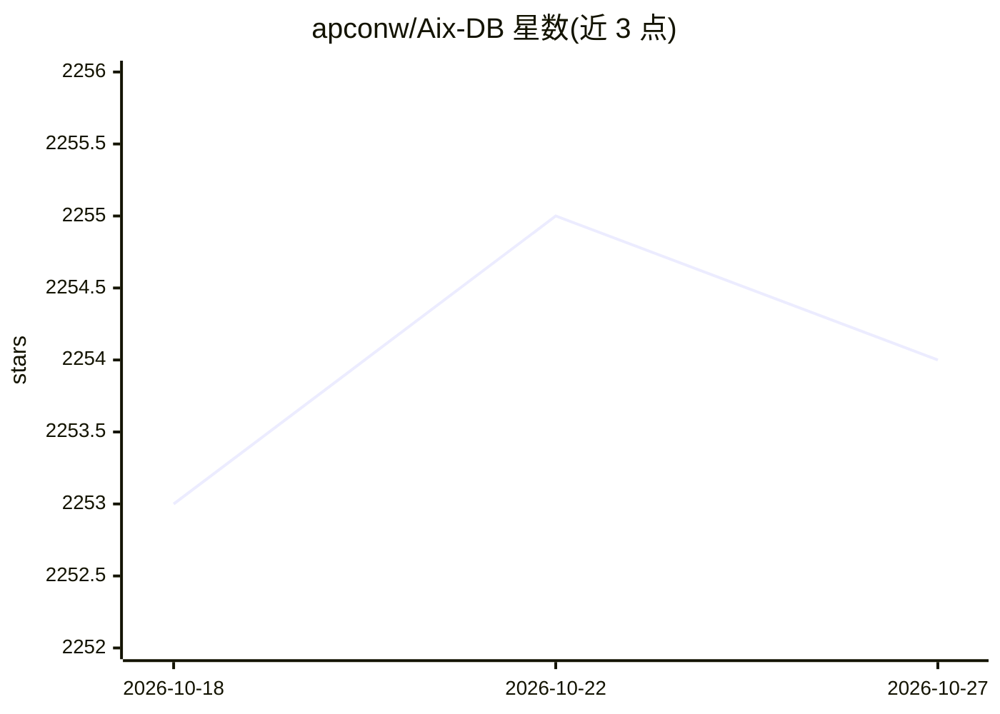

# apconw/Aix-DB

⭐ 2,254 · JavaScript · 推送 2026-10-10 · [GitHub](https://github.com/apconw/Aix-DB) · [官网](https://db.aixhub.top/) · 个人维护 · 中文 README

**基于 LLM/RAG 的对话式数据分析系统（ChatBI）**

基于 LangChain/LangGraph 与 MCP Skills 多智能体协作架构的智能数据分析系统，实现自然语言到数据洞察的端到端转换：LLM 意图理解、Embedding+BM25 混合检索结合 Neo4j 图谱、Text2SQL 生成与执行、ECharts/AntV 自动可视化。支持智能问答、表格问答、深度问数、Skill 模式与 OpenClaw 集成，提供 Docker/Compose 部署、Vue3 Web 界面与 npm CLI。另有 Aix-DB Pro 商业版，支持更多国产与主流数据库及看板/报告功能，开源版采用 Apache 2.0。

## 筛选速览

| 维度 | 判定 | 备注 |
|---|---|---|
| AI 角色 | `ai-native` | 本体是模型或模型工具 |
| 许可风险 | `none` | — |
| 部署形态 | `self-host` | docker 或自建部署 |
| 模型依赖 | — | README 未给出锁定关系 |
| 硬件要求 | — | 无带数字的原话,不猜 |
| 安装摩擦 | `low` | 无编译、无系统依赖或容器化 |
| 成熟度 | — | 结构信号不足 |

## 能力要点

- Text2SQL + RAG（Embedding+BM25+Neo4j 图谱）数据问答流程
- MCP 多智能体协作与 Skill 技能中心模式
- 自动生成 ECharts/AntV 可视化图表
- Docker Compose 一键部署与 npm CLI 命令行查询

## 适用场景

- 用自然语言查询业务数据库并自动出图
- 企业内部构建对话式 BI（ChatBI）分析入口
- 通过 CLI 在终端发起数据查询并渲染图表

## 场景标签

`数据分析` `RAG` `多智能体` · 领域:Agent 开发

## 证据(README 行号)

> L7:  基于大语言模型和RAG技术的智能数据分析系统，实现对话式数据分析（ChatBI），快速实现数据提取与可视化
> L18: Aix-DB 基于 **LangChain/LangGraph** 框架，结合 **MCP Skills** 多智能体协作架构，实现自然语言到数据洞察的端到端转换。
> L20: **核心能力**：智能问答 · 数据问答（Text2SQL） · 表格问答 · 深度问数 · 数据可视化 · MCP 多智能体 · Skill 模式

## 星数曲线

2026-10-18 2,253 → 2026-10-27 2,254（+1）

---
*卡片 v1 · prompt 1.4 · 生成 2026-10-21 · 置信度 high · 依据 README sha `5d8638b93c53` · [字段定义](../../DATASET.md)*
