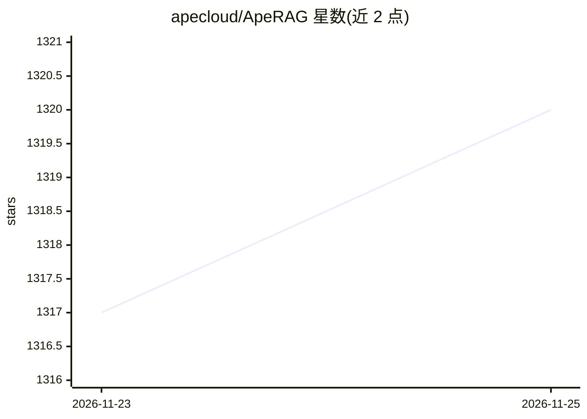

# apecloud/ApeRAG

⭐ 1,320 · Python · Apache-2.0 · 推送 2026-10-29 · [GitHub](https://github.com/apecloud/ApeRAG) · [官网](https://apemind.ai) · 组织维护 · 中文 README

**生产级 RAG 平台：构建知识图谱并支持多模态检索与 AI Agent**

ApeRAG 是一个生产就绪的 RAG 平台，组合 Graph RAG、向量检索与全文检索，提供向量、全文、图谱、摘要、视觉五种索引类型，并内置可调用 MCP 工具的 AI Agent，支持自动识别相关集合、智能检索与联网搜索。其图谱能力基于深度修改的 LightRAG 实现，加入实体归一化，并集成 MinerU 文档解析服务（可选 GPU 加速）。部署方式包括 Docker Compose 与带 Helm Chart 的 Kubernetes，依赖 PostgreSQL、Redis、Qdrant、Elasticsearch 等数据库服务，提供审计日志、模型管理等企业管理功能。

## 筛选速览

| 维度 | 判定 | 备注 |
|---|---|---|
| AI 角色 | `ai-ecosystem` | LLM/agent 周边工具 |
| 许可风险 | `permissive` | Apache-2.0 |
| 部署形态 | `self-host` | docker 或自建部署 |
| 模型依赖 | — | README 未给出锁定关系 |
| 硬件要求 | — | 无带数字的原话,不猜 |
| 安装摩擦 | `low` | 无编译、无系统依赖或容器化 |
| 成熟度 | — | 结构信号不足 |

## 能力要点

- 五种索引类型：Vector、Full-text、Graph、Summary、Vision
- 内置 MCP 工具支持的 AI Agent，自动检索与联网搜索
- 基于深度修改的 LightRAG，支持实体归一化
- Kubernetes 部署：Helm Chart 与 KubeBlocks 集成

## 适用场景

- 企业知识库问答与知识图谱构建
- 文档智能检索与混合搜索应用开发
- 通过 MCP 让 AI 助手直接访问知识库
- 生产环境部署可扩展的 RAG 服务

## 场景标签

`RAG` `知识图谱` `文档问答` `文档解析` · 领域:知识与检索

## 证据(README 行号)

> L8: ApeRAG is a production-ready RAG (Retrieval-Augmented Generation) platform that combines Graph RAG, vector search, a
> L95: Five comprehensive index types for optimal retrieval: **Vector**, **Full-text**, **Graph**, **Summary**, and **Visi
> L113: Full Kubernetes support with Helm charts and KubeBlocks integration for simplified deployment of production-grade 

## 星数曲线

2026-11-23 1,317 → 2026-11-25 1,320（+3）

---
*卡片 v1 · prompt 1.4 · 生成 2026-11-24 · 置信度 high · 依据 README sha `c81bbc832a20` · [字段定义](../../DATASET.md)*
