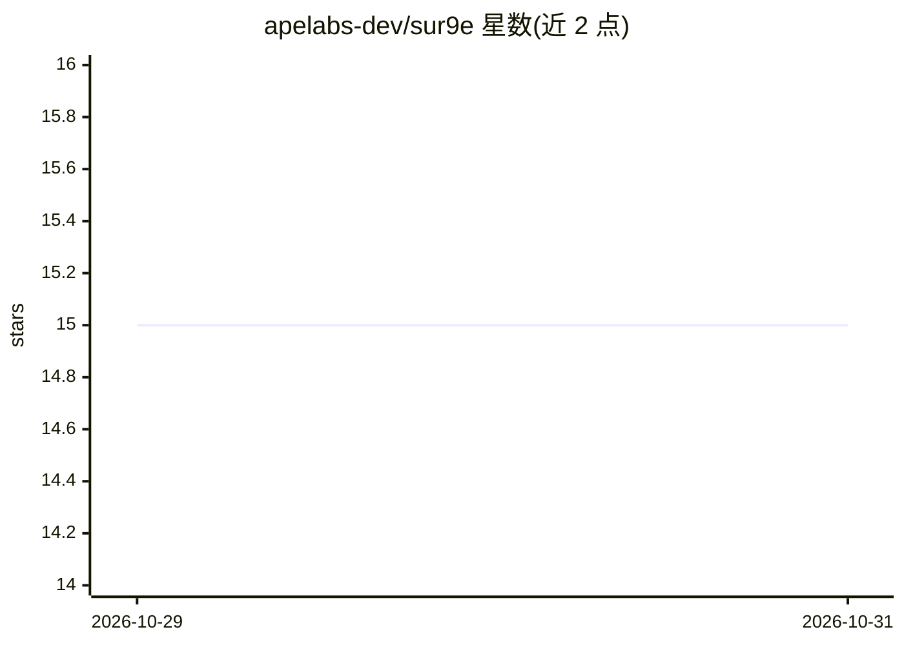

# apelabs-dev/sur9e

⭐ 15 · TypeScript · MIT · 推送 2026-10-28 · [GitHub](https://github.com/apelabs-dev/sur9e) · [官网](https://sur9e.com/) · 组织维护

**本地自托管的 AI 求职工具箱：评估职位、筛选 JD、定制简历**

sur9e 将 AI 编程 CLI（Claude Code、Codex、OpenCode）作为运行时与命令入口，配合本地 Next.js Web 界面，对求职者提供职位贴两阶段评估（廉价初筛+深度评分）、按 offer 定制简历与求职信、面试准备、公司调研、offer 比较与投递跟踪。数据（CV、评估报告）以本地文件存储，无遥测，不自动提交申请。职位发现来自 ATS 门户纯 HTTP 扫描与 JobSpy 爬虫（LinkedIn/Indeed/Google）。需 Node 20+、Python 3.10+ 及至少一个 AI 编程 CLI，目前要求一定终端操作能力，非技术用户的一键安装在路线图中。

## 筛选速览

| 维度 | 判定 | 备注 |
|---|---|---|
| AI 角色 | `ai-native` | 本体是模型或模型工具 |
| 许可风险 | `permissive` | MIT |
| 部署形态 | `None` |  |
| 模型依赖 | — | README 未给出锁定关系 |
| 硬件要求 | — | 无带数字的原话,不猜 |
| 安装摩擦 | `low` | 无编译、无系统依赖或容器化 |
| 成熟度 | — | 结构信号不足 |

## 能力要点

- 两阶段流水线：廉价初筛 triage 后仅对候选做深度评估（原型契合、薪酬分析、合法性检查）
- 以 AI 编程 CLI 为运行时，读取 CLAUDE.md/AGENTS.md，无独立二进制
- ATS 门户零 token 纯 HTTP 扫描 + JobSpy 公开职位板爬取，均本地运行
- 每次运行按 provider/model 记录 token 与估算美元成本（OpenRouter 实时价格）

## 适用场景

- 把职位贴 URL 粘进对话，自动完成筛选、评分与匹配表生成
- 从已评估的 offer 生成定制 CV PDF 与求职信再人工提交
- 在本地看板中跟踪所有投递状态与跟进节奏
- 通过 Tailscale 在手机上访问同一套求职流水线

## 场景标签

`网页抓取` · 领域:效率与自动化

## 证据(README 行号)

> L33: Sur9e turns an AI coding agent — **Claude Code, Codex, or OpenCode** — into a job-hunt copilot that actually knows 
> L35: **Who it's for:** anyone running a deliberate, quality-over-quantity job hunt — not a spray-and-pray autoclicker. Y

## 星数曲线

2026-10-29 15 → 2026-10-31 15（+0）

---
*卡片 v1 · prompt 1.4 · 生成 2026-10-30 · 置信度 high · 依据 README sha `d1ff66ac0eb6` · [字段定义](../../DATASET.md)*
