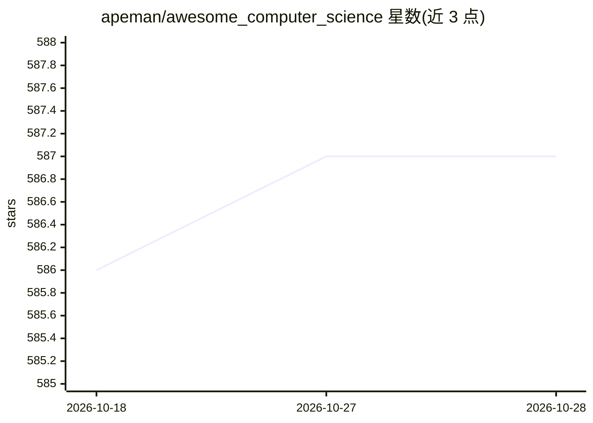

# apeman/awesome_computer_science

⭐ 587 · MPL-2.0 · 推送 2026-05-20 · [GitHub](https://github.com/apeman/awesome_computer_science) · 个人维护

**计算机科学与工程本科课程的完整大纲核对清单**

以实用核对清单（checkbox）形式组织计算机科学与工程本科完整教学大纲，分四部分：硬件与工程（数字电子、计算机组成、计算理论）、编程与核心 CS（编译原理、C/C++、数据结构、算法、人工智能）、系统 CS（数据库、操作系统、网络、软件工程）、实际应用（密码学、数据科学、Web 开发、计算机图形学）。面向初学者提供学习路线图与进度勾选，末尾附项目练习清单链接。仅为课程大纲清单，不含代码实现。

## 筛选速览

| 维度 | 判定 | 备注 |
|---|---|---|
| AI 角色 | `ai-knowledge` | 知识聚合/清单类 |
| 许可风险 | `permissive` | MPL-2.0 |
| 部署形态 | `None` |  |
| 模型依赖 | — | README 未给出锁定关系 |
| 硬件要求 | — | 无带数字的原话,不猜 |
| 安装摩擦 | `low` | 无编译、无系统依赖或容器化 |
| 成熟度 | — | 结构信号不足 |

## 能力要点

- 四大部分覆盖从数字电路到计算机图形学的本科 CS 课程
- 全部条目以 checkbox 形式可勾选追踪进度
- 附项目练习清单（what-should-i-code.md）链接

## 适用场景

- 按清单系统自学计算机科学本科课程
- 核对自身知识覆盖面、查漏补缺
- 寻找配套编程练习项目

## 场景标签

`精选清单` `教程课程` · 领域:学习与行业

## 证据(README 行号)

> L1: # 🧠 Computer Science and Engineering Roadmap and Checklist
> L3: > Complete syllabus of **Computer Science and Engineering (UG)**, structured as a practical checklist.

## 星数曲线

2026-10-18 586 → 2026-10-28 587（+1）

---
*卡片 v1 · prompt 1.4 · 生成 2026-10-21 · 置信度 high · 依据 README sha `8e989b017ad4` · [字段定义](../../DATASET.md)*
