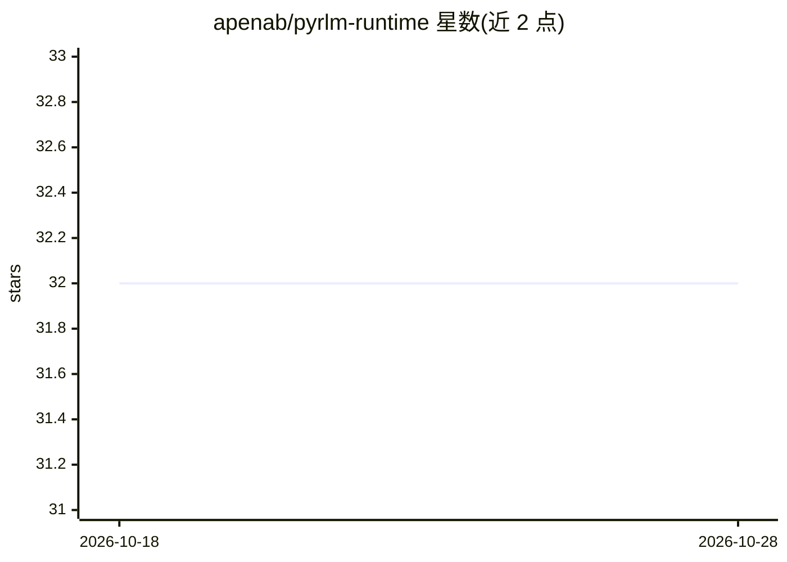

# apenab/pyrlm-runtime

⭐ 32 · Python · MIT · 推送 2026-09-01 · [GitHub](https://github.com/apenab/pyrlm-runtime) · [官网](https://arxiv.org/html/2512.24601v1) · 个人维护

**递归语言模型（RLM）的 Python 运行时库，处理长上下文**

受 MIT CSAIL 论文启发的 RLM 运行时库：将大上下文作为环境状态放入 Python REPL，LLM 写代码检索、切分数据并对小模型做递归子调用，以每步恒定 token 处理任意长上下文。提供 OpenAI 兼容/Vertex AI/自定义/Fake 等适配器、SmartRouter 按上下文大小自动路由、文件缓存、两种重排器、多查询检索与追踪调试。通过 pip 安装，需 Python 3.12+ 与 LLM API key。

## 筛选速览

| 维度 | 判定 | 备注 |
|---|---|---|
| AI 角色 | `ai-ecosystem` | LLM/agent 周边工具 |
| 许可风险 | `permissive` | MIT |
| 部署形态 | `library` | 以包/库形式分发 |
| 模型依赖 | local-ok | 支持本地模型 |
| 硬件要求 | — | 无带数字的原话,不猜 |
| 安装摩擦 | `low` | 无编译、无系统依赖或容器化 |
| 成熟度 | — | 结构信号不足 |

## 能力要点

- 上下文置于 REPL，LLM 写代码检查/搜索/切分并递归子调用小模型
- 适配 OpenAI 兼容 API（OpenAI/Anthropic 代理/Ollama/LM Studio/vLLM）、Vertex AI 与自定义协议
- SmartRouter 按上下文大小在直接调用与 RLM 间自动选择
- ListwiseReranker/TournamentReranker 与 QueryRewriter 多查询检索组件

## 适用场景

- 处理超出 LLM 上下文窗口的超长文档问答
- 长上下文任务的检索重排与多查询扩展
- 以确定性 FakeAdapter 离线测试 RLM 循环

## 场景标签

`文档问答` · 领域:知识与检索

## 证据(README 行号)

> L5: Minimal Python runtime for **Recursive Language Models (RLMs)** — inspired by the MIT CSAIL paper _"Recursive Langua
> L151: Adapters connect pyrlm-runtime to any LLM provider.

## 星数曲线

2026-10-18 32 → 2026-10-28 32（+0）

---
*卡片 v1 · prompt 1.4 · 生成 2026-10-26 · 置信度 high · 依据 README sha `a0aadd105ab8` · [字段定义](../../DATASET.md)*
