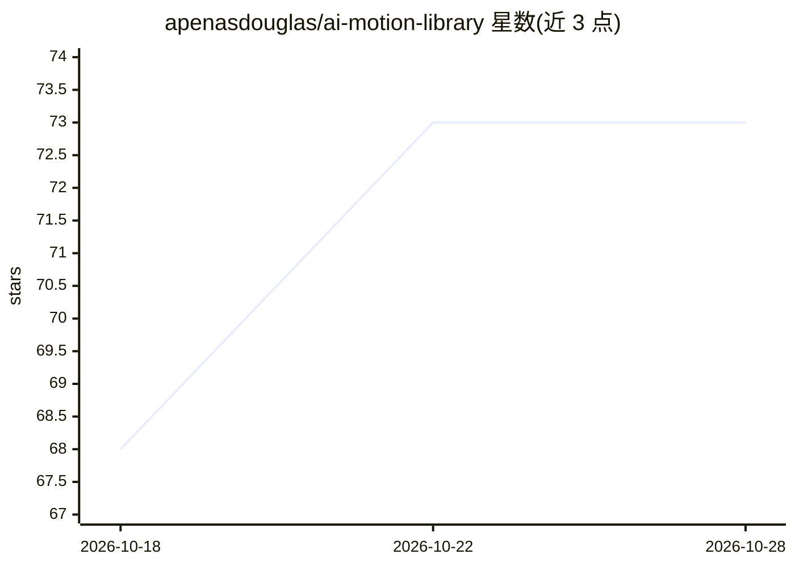

# apenasdouglas/ai-motion-library

⭐ 73 · MIT · 推送 2026-10-14 · [GitHub](https://github.com/apenasdouglas/ai-motion-library) · [官网](https://apenasdouglas.github.io/ai-motion-library/) · 个人维护

**面向 Claude Code 的 24 种动画效果提示词库与技能包**

用葡萄牙语命名的 24 种 motion graphics 动画效果目录：每个效果给出名称、请求 AI 时使用的术语和可复制的示例提示词，按入场、节奏、文本与数字、形状与转场四类组织，另含按场景组合效果的'暗色频道'配方表和配色主题说明。提供可安装到 Claude Code 的 SKILL.md 技能（支持按颜色名/十六进制/命令设置配色），也可将表格内容粘贴到其他工具的项目指令文件中使用。面向运营无真人出镜纪录片类 YouTube 频道、需要视频动效但不雇佣动效师的创作者，MIT 许可。

## 筛选速览

| 维度 | 判定 | 备注 |
|---|---|---|
| AI 角色 | `ai-knowledge` | 知识聚合/清单类 |
| 许可风险 | `permissive` | MIT |
| 部署形态 | `None` |  |
| 模型依赖 | — | README 未给出锁定关系 |
| 硬件要求 | — | 无带数字的原话,不猜 |
| 安装摩擦 | `low` | 无编译、无系统依赖或容器化 |
| 成熟度 | — | 结构信号不足 |

## 能力要点

- 24 种动画效果各附术语与可复制的示例提示词
- 10 个按场景组合效果的配方（暗色频道视频场景）
- 提供 Claude Code 技能安装，支持颜色与深浅主题设置
- 附 Ken Burns 等清单外常用效果与示例请求

## 适用场景

- 让 AI 按正确术语生成视频动画效果
- 为无真人出镜的纪录片类频道按场景查组合配方
- 把效果表粘贴到 Cursor/AGENTS.md 等项目指令文件中复用

## 场景标签

`提示工程` · 领域:Agent 开发

## 证据(README 行号)

> L9: Aqui estão **24 efeitos de motion graphics** com o nome em português, o termo que você usa no pedido e um exemplo pr
> L33: 1. **Só consultar.** Achou o efeito na tabela, copia o exemplo de pedido e cola no seu Claude, ChatGPT, Codex ou Cu

## 星数曲线

2026-10-18 68 → 2026-10-28 73（+5）

---
*卡片 v1 · prompt 1.4 · 生成 2026-10-24 · 置信度 high · 依据 README sha `07420c6074c6` · [字段定义](../../DATASET.md)*
