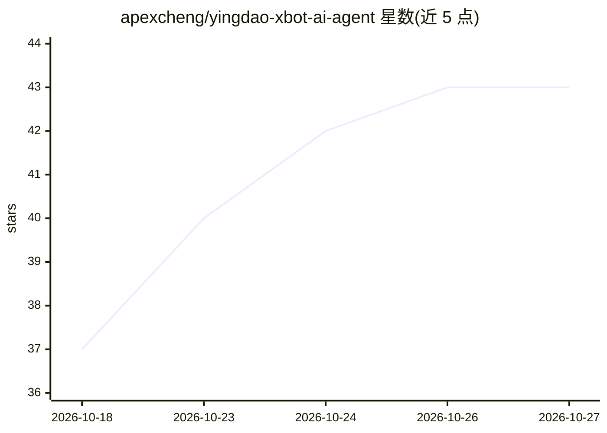

# apexcheng/yingdao-xbot-ai-agent

⭐ 43 · Python · MIT · 推送 2026-10-26 · [GitHub](https://github.com/apexcheng/yingdao-xbot-ai-agent) · [官网](https://github.com/apexcheng/yingdao-xbot-ai-agent/tree/main/docs) · 个人维护 · 中文 README

**影刀 xbot/RPA 开发的中文 AI Agent 知识库**

个人维护的影刀编码版（xbot）开发知识库，服务于使用 Codex、Claude Code、Cursor 等 AI 编程工具开发影刀 RPA 项目的开发者。内容涵盖 xbot API 事实文档（浏览器、Excel/WPS、Windows 自动化、市场指令参数映射）、四个可复制的 Skill（代码质量、影刀工具、开发经验、表格操作）、项目模板与真实案例源码快照。提供同步脚本将规则批量同步到本机影刀项目；声明非官方文档，宿主侧插件、MCP、Computer Use 不在维护范围。

## 筛选速览

| 维度 | 判定 | 备注 |
|---|---|---|
| AI 角色 | `ai-knowledge` | 知识聚合/清单类 |
| 许可风险 | `permissive` | MIT |
| 部署形态 | `None` |  |
| 模型依赖 | — | README 未给出锁定关系 |
| 硬件要求 | — | 无带数字的原话,不猜 |
| 安装摩擦 | `low` | 无编译、无系统依赖或容器化 |
| 成熟度 | — | 结构信号不足 |

## 能力要点

- xbot API 与市场指令的事实页文档（含源码核验）
- project-template 含 base 骨架与四个 Skill
- sync_agent_rules.py 批量同步 Agent 规则到本机影刀项目
- 真实项目案例库（抖音经营报表、库存监控源码快照）

## 适用场景

- 用 Claude Code/Codex 开发影刀编码版项目时提供 API 事实依据
- 排查影刀项目同步、发布与部署问题
- 为影刀项目快速搭建带 Agent 规则的 base 骨架

## 场景标签

`教程课程` · 领域:学习与行业

## 证据(README 行号)

> L3: > 面向影刀 xbot / 编码版、RPA 自动化和 AI 编程 Agent 的中文开发知识库。
> L13: 这是我在实际开发和维护影刀自动化项目时，为个人 AI 辅助开发流程持续整理的知识库。它首先服务于我自己的项目，同时公开出来，希望给同样使用 Codex、Claude Code、Cursor 等工具开发影刀编码版的开发者一些参考。
> L33: ### AI Agent 开发规则

## 星数曲线

2026-10-18 37 → 2026-10-27 43（+6）

---
*卡片 v1 · prompt 1.4 · 生成 2026-10-25 · 置信度 high · 依据 README sha `c2661013ddfa` · [字段定义](../../DATASET.md)*
