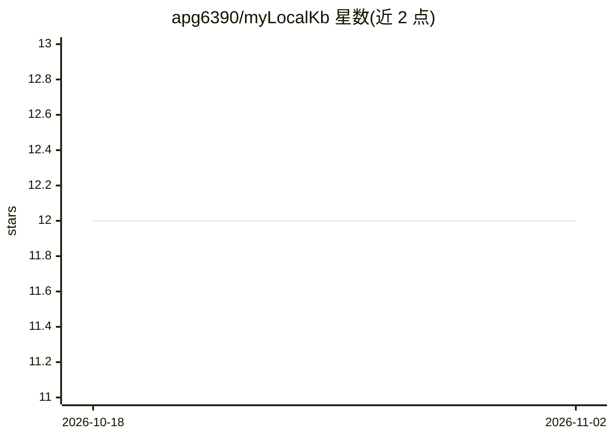

# apg6390/myLocalKb

⭐ 12 · Python · NOASSERTION · 推送 2026-10-28 · [GitHub](https://github.com/apg6390/myLocalKb) · 个人维护

**离线本地优先的个人知识库：文档上传、向量检索与 Ollama RAG 问答**

面向个人用户的本地优先知识库应用：上传 PDF/DOCX/PPTX/TXT/MD 文档后本地解析、通过 Ollama 生成嵌入并存入本地 ChromaDB，聊天问答仅基于检索片段生成并返回来源文件名，检索不足时返回固定未找到回复。全程无云端 LLM API 与密钥，数据留在本机。FastAPI 后端加无构建步骤的原生 HTML/JS 前端，git clone 后运行 setup 脚本安装依赖并拉取模型，单用户本地使用，自称早期 alpha。

## 筛选速览

| 维度 | 判定 | 备注 |
|---|---|---|
| AI 角色 | `ai-native` | 本体是模型或模型工具 |
| 许可风险 | `none` | NOASSERTION |
| 部署形态 | `library` | 以包/库形式分发 |
| 模型依赖 | local-ok | 支持本地模型 |
| 硬件要求 | — | 无带数字的原话,不猜 |
| 安装摩擦 | `low` | 无编译、无系统依赖或容器化 |
| 成熟度 | `idea` | |

## 能力要点

- Ollama 本地嵌入与本地 LLM（默认 qwen3:4b），ChromaDB 本地向量存储
- 回答附来源文件名，上下文不足时拒绝作答的保守行为
- 支持 PDF/DOCX/PPTX/TXT/MD 上传索引，无云端 API 依赖与密钥
- 提供 REST API（文档上传/列表/删除、问答）与 pytest 测试

## 适用场景

- 把个人文档收进本地知识库并直接提问
- 在无网络或注重隐私的环境下做 RAG 问答
- 基于检索片段获得带来源、可拒绝回答的问答结果

## 场景标签

`文档问答` `知识库管理` · 领域:知识与检索

## 证据(README 行号)

> L3: myLocalKb is an offline, local-first personal knowledge base with document upload, local vector search, and an Ollam
> L5: Upload documents, index them locally, and ask grounded questions against your own files. The app uses local embeddin
> L23: - Answer questions with a local Ollama chat model

## 星数曲线

2026-10-18 12 → 2026-11-02 12（+0）

---
*卡片 v1 · prompt 1.4 · 生成 2026-11-01 · 置信度 mid · 依据 README sha `9b1550f3ca4e` · [字段定义](../../DATASET.md)*
